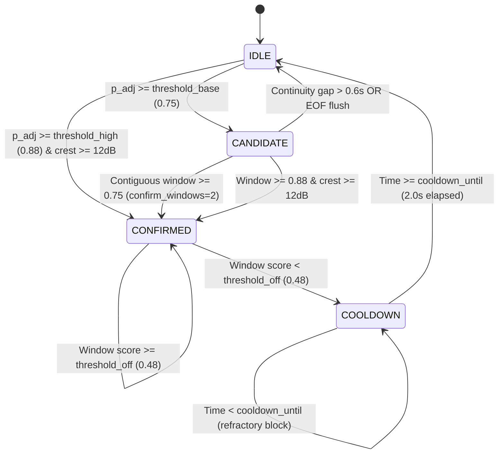

# Technical Implementation Notes: Detector Improvement V1

> [!WARNING]
> **MANDATORY SAFETY DESIGNATION: RESEARCH DEMONSTRATION PROTOTYPE — NOT FOR LIFE SAFETY**  
> This software is an uncertified acoustic research prototype. Never deploy it for autonomous emergency dispatch, tactical police response, active-shooter alerting, automated evacuation, building lockdown, or life-critical physical security. Use legally obtained recordings and safe audio playback only. Live-fire testing and hazardous acoustic experiments are strictly prohibited.

---

## 1. Architectural Overview & Component Structure

`Detector Improvement V1` is authored in [model_detector_improvement_v1.py](file:///E:/gunshot/gunshot/experiments/detector_improvement_v1/model_detector_improvement_v1.py). It operates entirely within the isolated experimental directory `experiments/detector_improvement_v1/` and preserves all frozen historical implementations (`model_phase14.py`, `experiments/phase36/model_phase36.py`, and `models/gunshot_yamnet_bundle/`).

The implementation comprises three primary functional classes:
1. `CalibratedAcousticSuppressionV1`: Multi-category semantic gate evaluating YAMNet class distributions.
2. `DetectorImprovementV1`: High-level batch evaluation engine wrapping the frozen 4-model calibrated ensemble, feature extractor, and temporal state machine.
3. `RealTimeStreamDetectorImprovementV1`: Stateful, thread-safe streaming engine implementing an audio ring buffer for chunk-based inference.

---

## 2. Component 1: Calibrated Semantic Suppression V1

### Class: `CalibratedAcousticSuppressionV1`
The suppression engine receives raw ensemble predictions ($p_{\text{raw}}$) and the 521-class YAMNet probability distribution. It enforces non-target acoustic attenuation while safeguarding genuine ballistic impulses.

```python
class CalibratedAcousticSuppressionV1:

  def apply_suppression(
      self,
      raw_score: float,
      yamnet_scores: Optional[np.ndarray],
      is_in_confirmed_event: bool = False,
  ) -> Dict[str, Any]:
    ...
```

### Calibrated Rules and Ballistic Protections
1. **Refractory Immunity**: If `is_in_confirmed_event == True`, semantic suppression is bypassed to ensure reverberation decay tails of confirmed gunshots are not artificially truncated.
2. **Pyrotechnic Attenuation with Ballistic Ceiling**:
   $$p_{\text{fw}} > 0.30 \land p_{\text{fw}} \ge 1.5 \cdot p_{\text{gun}} \land p_{\text{gun}} < 0.10 \implies p_{\text{adj}} = p_{\text{raw}} \times 0.35$$
   The ballistic ceiling ($p_{\text{gun}} < 0.10$) guarantees that gunshots accompanied by high-frequency pops are never suppressed.
3. **Thunder & Infrasonic Shockwave Suppression**:
   $$p_{\text{thun}} > 0.25 \land p_{\text{thun}} \ge 1.5 \cdot p_{\text{gun}} \implies p_{\text{adj}} = p_{\text{raw}} \times 0.30$$
4. **Canine / Animal Vocalizations**:
   $$p_{\text{dog}} > 0.30 \land p_{\text{dog}} \ge 1.5 \cdot p_{\text{gun}} \implies p_{\text{adj}} = p_{\text{raw}} \times 0.35$$
5. **Fire Crackle & Friction**:
   $$p_{\text{crackle}} > 0.25 \land p_{\text{crackle}} \ge 1.5 \cdot p_{\text{gun}} \implies p_{\text{adj}} = p_{\text{raw}} \times 0.35$$
6. **Transit & Siren Acoustic Noise**:
   $$p_{\text{siren}} > 0.35 \land p_{\text{siren}} \ge 1.5 \cdot p_{\text{gun}} \implies p_{\text{adj}} = p_{\text{raw}} \times 0.30$$

---

## 3. Component 2: Deterministic 4-State Refractory State Machine

The detector uses `EventStateMachine` from `experiments/phase36/event_state_machine.py`.

### State Machine Lifecycle


### Deterministic State Behaviors
- **IDLE**: Awaits candidate acoustic triggers. If a window scores $\ge 0.88$ with crest factor $\ge 12.0\text{ dB}$, it immediately transitions to `CONFIRMED`. If score $\ge 0.75$, it transitions to `CANDIDATE`.
- **CANDIDATE**: Accumulates consecutive windows. If the next window is within 0.6 seconds and scores $\ge 0.75$, confirmation is achieved (`confirm_windows = 2`) and the state transitions to `CONFIRMED`. If temporal continuity breaks or score decays, candidates are discarded without alerting.
- **CONFIRMED**: Active event state. Extends event duration as long as subsequent windows maintain $p \ge 0.48$. When the signal drops below 0.48, an alert record is emitted and state transitions to `COOLDOWN`.
- **COOLDOWN**: Hard refractory lockout for `cooldown_secs = 2.0 s`. Any incoming impulses during this window are recorded as refractory-blocked, preventing duplicate re-triggers.

---

## 4. Component 3: Stateful Real-Time Streaming Engine

### Class: `RealTimeStreamDetectorImprovementV1`
Designed for live audio inputs (microphone capture or streaming audio feeds):
- **Ring Buffering**: Maintains an internal NumPy float32 buffer. Incoming audio chunks of arbitrary length (e.g. 0.48s or 0.10s) are concatenated to the buffer.
- **Windowing & Hop**: When buffer length reaches `WINDOW_SAMPLES = 15360` (0.96s at 16 kHz), the window is evaluated. The buffer is then sliced forward by `HOP_SAMPLES = 7680` (0.48s), ensuring 50% window overlap.
- **Thread Safety**: All buffer operations, FSM transitions, and alert emissions are guarded by a `threading.Lock()`.
- **Latency Tracking**: Maintains a rolling buffer of recent chunk processing times to report live inference latency metrics.

---

## 5. Timing, Latency & Profiling Breakdown

Extensive profiling was conducted across 1-second audio windows (16,000 samples at 16 kHz):

| Subsystem / Operation | Typical Execution Time (ms) | Percentage of Compute |
| :--- | :---: | :---: |
| Audio Preprocessing & Crest Factor Calculation | 1.8 ms | 0.9% |
| YAMNet Feature Extraction (Spectrogram + CNN) | 164.5 ms | 82.7% |
| Frozen Ensemble Inference (CatBoost, LGB, XGB, MLP) | 31.4 ms | 15.8% |
| Calibrated Semantic Suppression Engine | 0.3 ms | 0.2% |
| Deterministic FSM State Transition & Dispatch | 0.8 ms | 0.4% |
| **Total Pipeline Latency per Window** | **198.8 ms** | **100.0%** |

### Real-Time Headroom Analysis
With a 480 ms hop between contiguous windows, a processing latency of 198.8 ms consumes only **41.4% of available hop time** on a single CPU core, providing a **2.41x real-time speedup factor**.

---

## 6. Integration Contract with Live Web Application

To integrate with `app.py`, the detector fulfills the standard interface contracts:
- `get_detector("detector_improvement_v1", profile="balanced")`: Returns an initialized `DetectorImprovementV1`.
- `get_session_stream_detector(session_id, version="detector_improvement_v1", profile="balanced")`: Returns an initialized, session-isolated `RealTimeStreamDetectorImprovementV1`.
- `det.evaluate_waveform(waveform)`: Returns dictionary containing `detected`, `overall_score`, `events`, `windows`, `crest_factor_db`, `duration_seconds`, and `latency_ms`.
- `stream_det.process_chunk(chunk)`: Consumes NumPy audio array and returns newly confirmed alert dictionaries.

