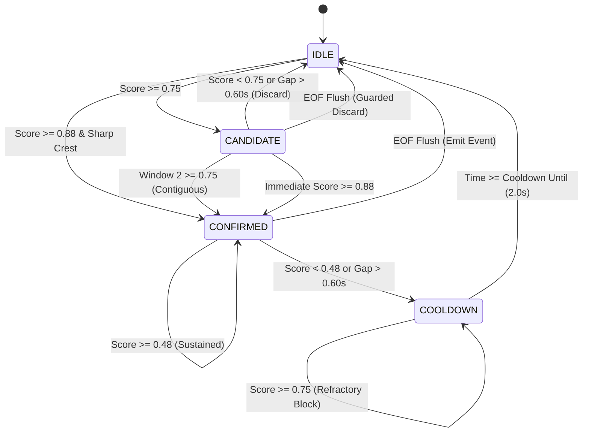

# PHASE 36 EXPERIMENTAL PROTOCOL
## Architecture, Event State Integrity & Independent Evaluation Protocol

> [!CAUTION]
> **MANDATORY SAFETY DESIGNATION: RESEARCH DEMONSTRATION PROTOTYPE — NOT FOR LIFE SAFETY.**
> This experimental acoustic machine-learning software is uncertified and must never be deployed for autonomous emergency dispatch, police tactical response, active-shooter alerting, automated evacuation, building lockdown, or life-critical physical security.
> Use legally obtained recordings and safe audio playback only. Live-fire testing and hazardous acoustic experiments are strictly prohibited.

---

## 1. Protocol Mission & Governance Boundary

Following the closure of the Phase 27–35 historical benchmark audit, Phase 36 establishes an independent, separately versioned experimental branch (`experiments/phase36/`) to investigate architecture, state-machine integrity, and suppression trade-offs without modifying any frozen historical baseline.

### Governance Directives:
1. **Phase 14 Balanced** remains the Default Research Baseline (`DEFAULT_RESEARCH_BASELINE`).
2. **Phase 17 Experimental** remains a frozen selectable experimental profile (`SELECTABLE_EXPERIMENTAL_PROFILE`).
3. The Phase 31 reset candidate remains a quarantined diagnostic prototype (`QUARANTINED_DIAGNOSTIC_PROTOTYPE`).
4. **Phase 36** is an independent experimental branch (`PHASE36_EXPERIMENTAL_EVENT_STATE_BRANCH_V1`).
5. Zero historical model weights, code, or archived benchmark files modified.

---

## 2. Experimental Architecture

---

## 3. Factorial Experiment Matrix

| Condition ID | Architecture | State Machine | Suppression Factor | Role |
|---|---|---|---|---|
| `COND1` | Phase 14 Balanced | Legacy Event Merger | None (Disabled) | `DEFAULT_RESEARCH_BASELINE` |
| `COND2` | Phase 17 Experimental | Defective Event Merger | Legacy Animal (0.30x) | `FROZEN_SELECTABLE_PROFILE` |
| `COND3` | Phase 17 Reset Candidate | Candidate State Reset Merger | Legacy Animal (0.30x) | `QUARANTINED_DIAGNOSTIC_REFERENCE` |
| `COND4` | Phase 36 Raw | Explicit 4-State FSM | None (Disabled) | `EXPERIMENTAL_BRANCH_CONDITION_1` |
| `COND5` | Phase 36 Legacy Suppression | Explicit 4-State FSM | Legacy Animal (0.30x) | `EXPERIMENTAL_BRANCH_CONDITION_2` |
| `COND6` | Phase 36 Conservative | Explicit 4-State FSM | Context-Aware Conservative (0.50x) | `EXPERIMENTAL_BRANCH_CONDITION_3` |

---

## 4. Independent Evaluation Inventory

A total of **87 distinct audio recordings** across three independent evaluation partitions (zero overlap with historical 23-stream set):
1. **Partition 1 (Continuous Negative Ambient):** 4 streams ($5.0000\text{ gross hours}$).
2. **Partition 2 (Controlled Ballistic Positives):** 23 continuous streams containing 53 annotated physical rounds (ShotSpotter Pittsburgh PA DQV 2018).
3. **Partition 3 (Reviewed Non-Target Distractors):** 60 curated acoustic distractors (balloon bursts, door slams, fireworks, metal impacts, vehicle backfires).

Full registry published in [phase36_dataset_registry.csv](file:///e:/gunshot/gunshot/reports/phase36_dataset_registry.csv).
