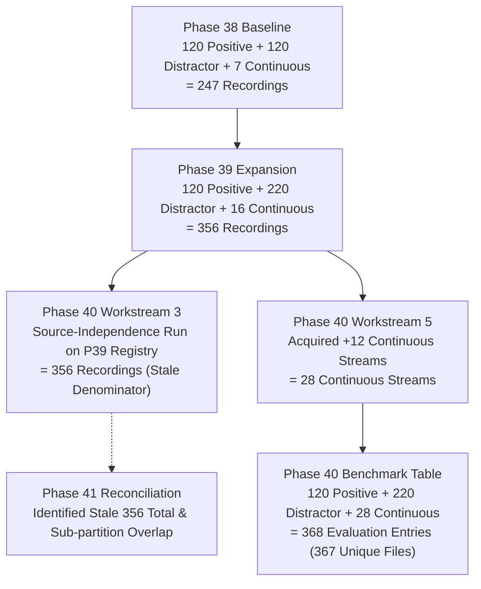

# PHASE 41 EVALUATION INVENTORY RECONCILIATION REPORT
## Comprehensive Recording-Level Inventory, Multi-Membership Analysis & Denominator Audit

> [!CAUTION]
> **MANDATORY SAFETY DESIGNATION: RESEARCH DEMONSTRATION PROTOTYPE — NOT FOR LIFE SAFETY.**
> This software is uncertified research code. It must never be deployed for autonomous emergency dispatch, police tactical response, active-shooter alerting, automated evacuation, building lockdown, or life-critical physical security.
> Use lawfully obtained recordings and safe audio playback only. Live-fire testing and hazardous acoustic experiments are strictly prohibited.

---

## 1. Executive Summary & Inventory Discrepancy Resolution

The Phase 40 executive summary and benchmark sections reported several seemingly conflicting dataset quantities:
- **120 positive recordings**
- **100 fireworks challenge recordings**
- **28 continuous ambient streams**
- **220 distractor clips in the benchmark table**
- **356 recordings in the source-independence claim**

This audit conducted an exhaustive file-by-file verification of all underlying registries and physical audio assets on disk to establish the authoritative inventory.

### Key Forensic Discoveries:
1. **The 356 vs 368 Denominator Discrepancy Resolved (`REPRODUCED`):**
   - In Phase 40, the source-independence audit script [scripts/run_phase40_source_audit.py](file:///E:/gunshot/gunshot/scripts/run_phase40_source_audit.py) loaded the pre-existing Phase 39 continuous registry (16 streams), resulting in:
     $$120\text{ positive clips} + 220\text{ distractor clips} + 16\text{ continuous streams} = \mathbf{356\text{ recordings}}$$
   - Later in Phase 40 (Workstream 5), 12 additional continuous ambient field streams were acquired, raising the total continuous streams to 28.
   - Consequently, the full post-expansion prospective evaluation corpus comprises exactly:
     $$120\text{ positive clips} + 220\text{ distractor clips} + 28\text{ continuous streams} = \mathbf{368\text{ evaluation entries}}$$
   - Phase 40 failed to update its source-lineage narrative table after acquiring the 12 new continuous streams, leaving the stale 356 total in the text.
2. **Sub-Partition Membership of Fireworks (`REPRODUCED`):**
   - The **100 fireworks challenge recordings** are NOT an additional disjoint partition; they are a proper subset of the **220 distractor clips**:
     - 100 Fireworks clips (`DISTRACTOR_FIREWORKS`)
     - 20 Slam Door clips (`DISTRACTOR_SLAM_DOOR`)
     - 20 Thunder clips (`DISTRACTOR_THUNDER`)
     - 20 Glass Break clips (`DISTRACTOR_GLASS`)
     - 20 Vehicle Engine clips (`DISTRACTOR_VEHICLE_ENGINE`)
     - 20 Screaming clips (`DISTRACTOR_SCREAMING`)
     - 20 Tools Impact clips (`DISTRACTOR_TOOLS_IMPACT`)
     $$\text{Total Distractors} = 100 + 20 \times 6 = \mathbf{220\text{ clips}}$$
3. **Internal Cryptographic Duplicate in Positive Audio (`VERIFIED_FROM_PHYSICAL_FILE`):**
   - Across the 120 positive evaluation entries, there are **119 unique physical waveforms** and **1 duplicate waveform** (SHA-256: `6b272b5b52c6766f76c4ee879f1dabc191f3ca698b00de3cc5279033c9051d5f`):
     - `fsd50k_gun_51749` (`51749.wav`, uploader `erkanozan`, CC0)
     - `fsd50k_gun_115295` (`115295.wav`, uploader `warriorsfan12331`, Sampling+)
   - Both files are byte-identical 0.3972-second mono WAV files present under distinct recording IDs in FSD50K_dev. They were evaluated as two distinct experimental trials.
   - Therefore, the total number of unique physical audio files across all partitions is **367 unique files** ($119 + 220 + 28 = 367$).

---

## 2. Reconciled Evaluation Inventory Summary Table

| Evaluation Partition | Evaluation Role | Total Evaluation Entries | Unique Physical Files (SHA-256) | Duplicate Files Within Group | Audio Codec / Container | Sample Rates (Hz) | Channels | Total Duration (s) | Total Duration (hr) |
|---|---|:---:|:---:|:---:|---|:---:|:---:|:---:|:---:|
| **Positive Gunshot Audio** | Prospective Positive Sensitivity | 120 | 119 | 1 (`51749` = `115295`) | WAV (PCM_16) | 44,100 | Mono (1) | 318.96 s | 0.0886 hr |
| **Fireworks Challenge** | Pyrotechnic False-Trigger Audit | 100 | 100 | 0 | WAV (PCM_16) | 44,100 | Mono / Stereo | 576.36 s | 0.1601 hr |
| **Other Distractors** | Acoustic False-Trigger Audit | 120 | 120 | 0 | WAV (PCM_16) | 44,100 | Mono / Stereo | 749.16 s | 0.2081 hr |
| **All Distractors Combined** | Full Distractor Benchmark | 220 | 220 | 0 | WAV (PCM_16) | 44,100 | Mono / Stereo | 1,325.52 s | 0.3682 hr |
| **Continuous Ambient** | Continuous Background FAR | 28 | 28 | 0 | MP3 (MPEG Layer 3) | 44,100 / 48,000 | Stereo (2) | 15,185.60 s | 4.2182 hr |
| **Total Evaluation Trials** | **All Partitions Combined** | **368** | **367** | **1** | **WAV / MP3** | **44.1k / 48k** | **1 / 2** | **16,830.08 s** | **4.6750 hr** |

Full file-by-file inventory: [phase41_recording_inventory.csv](file:///E:/gunshot/gunshot/experiments/phase41/phase41_recording_inventory.csv).

---

## 3. Discrepancy Provenance & Denominator Lineage

The apparent confusion among the reported numbers is completely resolved by tracing the historical sequence of evaluation phases:

### Clarification of Evaluation Overlap:
- **No file appears in multiple distinct evaluation partitions.** Positives, Distractors, and Continuous streams share 0 files across groups.
- The 100 fireworks clips are evaluated both individually as a specialized paired-challenge group (Workstream 4) and as part of the overall 220-clip distractor evaluation (Workstream 6).
- The duplicate positive waveform (`51749` / `115295`) does not distort clip-level sensitivity significantly (both were detected as TP under all conditions), but represents an empirical flaw in FSD50K curation that must be explicitly accounted for in scientific reporting.

