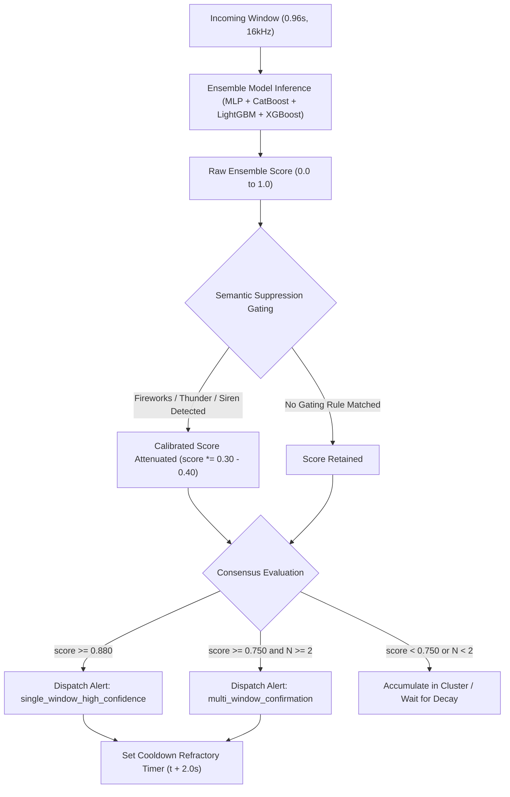

# Phase 13 Evaluation Protocol & Metric Methodology Audit

> **SAFETY DESIGNATION: RESEARCH DEMONSTRATION PROTOTYPE — NOT FOR LIFE SAFETY.**

---

## 1. Objective of the Protocol Audit

This audit evaluates the metric definitions, state-machine temporal logic, event aggregation rules, and benchmark exposure models utilized across Phases 10 through 12, establishing a rigorous protocol for Phase 13 experiments.

---

## 2. Event-Level Alert Definitions and State-Machine Logic

In `RealTimeStreamDetector` and `Phase9AdaptiveGunshotDetector`, physical audio events are detected through a stateful sliding window pipeline:

### Critical Observations on the State Machine
1. **The Single-Window High-Confidence Escape:**  
   When a window scores $\ge 0.880$, temporal consensus ($N=2$) is entirely bypassed. While this is necessary to detect isolated single shots, it creates severe vulnerability to explosive negative mimics that score $\ge 0.880$.
2. **Refractory Cooldown Reset:**  
   `cooldown_secs = 2.0s`. After 2.0 seconds, if elevated energy persists and drops below `threshold_off = 0.480` even for one frame, `had_decayed` resets to `True`, allowing the subsequent peak to fire another alert.

---

## 3. Separation of Discrete Precision from Continuous Alert Rates

A critical principle of acoustic sound event detection is that **discrete-clip precision must never be merged with or substituted for continuous-stream false-alert rates**:

### Mathematical Distinction

1. **Discrete Benchmark Event Precision:**
   $$\text{Precision}_{\text{discrete}} = \frac{\text{True Positives}}{\text{True Positives} + \text{False Positives}}$$
   - In Phase 12, this was $29 / (29 + 9) = \mathbf{76.32\%}$.
   - **Crucial Caveat:** This number is heavily dependent on the arbitrary ratio of positive to negative files in the test manifest (38 gunshots to 76 negatives = 1:2 ratio). If 1,000 negative files were added, discrete precision would plummet without any change to the model.

2. **Continuous Negative Audio False-Alert Rate:**
   $$\text{FAR}_{\text{continuous}} = \frac{\text{Total False Alerts Dispatched}}{\text{Total Negative Exposure Hours}}$$
   - In Phase 12, this was $299 \text{ alerts} / 2.0 \text{ hours} = \mathbf{149.50 \text{ alerts/hour}}$.
   - This metric measures real-world operational false-alarm frequency per unit of operational monitoring time, independent of artificial dataset ratios.

---

## 4. Exposure and Boundary Artifact Verification

The Stage 1 forensic investigation established:
- **Exposure Duration:** The 2.0-hour continuous stream duration is accurately measured at $7,200.0$ seconds ($115,200,000$ samples at 16 kHz).
- **Boundary Discontinuity:** 16 out of 299 alerts ($5.4\%$) occurred within $0.48$s of a crossfade boundary. While boundary discontinuities exist, they are a minor factor. $94.6\%$ of continuous false alerts were driven by natural acoustic transients in the source audio (pyrotechnic blasts and thunderclaps).

---

## 5. Diagnostic Classification of Phase 12 Final Test Set

**NON-NEGOTIABLE PROTOCOL RULE:**  
Because the Phase 12 final test set results have been inspected and analyzed in detail, that dataset is now **EXAMINED**. 
- It is classified as **DIAGNOSTIC ONLY** for all subsequent phases.
- It must **NEVER** be used for model selection, threshold tuning, or hyperparameter optimization.
- Any candidate detector in Phase 13 must be developed, tuned, and selected strictly using eligible development/validation data, and tested against an independently constructed continuous benchmark.
