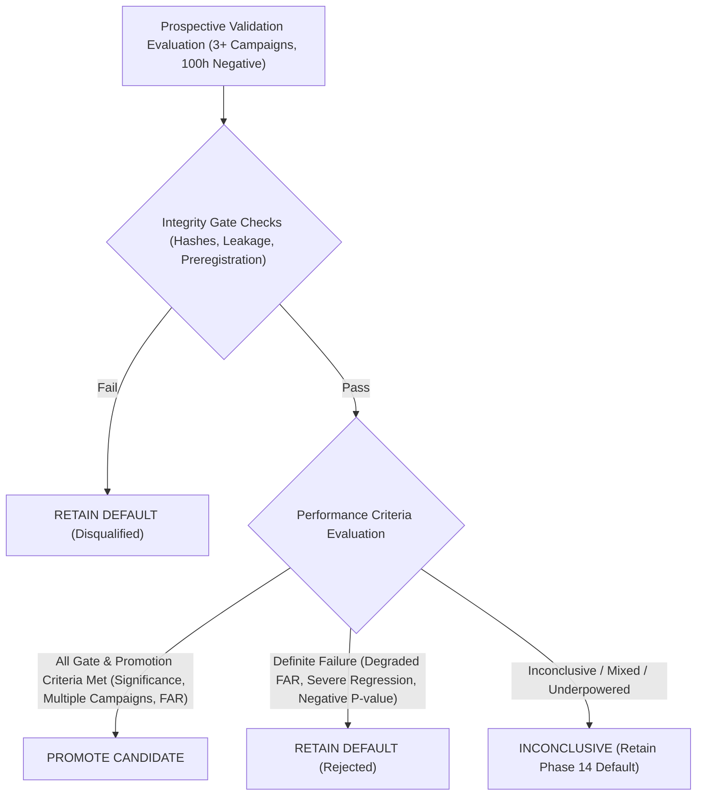

# Prospective Model Promotion Decision Framework
## Preregistered Criteria for Baseline Transition and Architecture Elevation

**Document ID:** `REPORT-PHASE22-PROMO-001`  
**Version:** 1.0 (Preregistered Decision Rules)  
**Date:** November 2026  
**Status:** PREREGISTERED SPECIFICATION  

---

### MANDATORY SAFETY DESIGNATION
> [!CAUTION]
> **RESEARCH DEMONSTRATION PROTOTYPE — NOT FOR LIFE SAFETY.**  
> This experimental acoustic machine-learning system is uncertified and must never be deployed for autonomous emergency dispatch, tactical police response, active-shooter alerting, automated lockdown/evacuation, or life-critical physical security. Use legally obtained recordings and safe audio playback only. Live-fire testing and hazardous acoustic experiments are strictly prohibited.

---

## 1. Context & Motivation

In Phase 20 and Phase 21, `model_phase17.py` (Experimental Profile) demonstrated higher round-level recall on the Pittsburgh controlled live-fire dataset (33/50 rounds detected vs. 27/50 for `model_phase14.py` Balanced Profile). However, rigorous retrospective auditing revealed:
1. **Cluster Dependence:** The 50 rounds are clustered within just 20 audio files across 5 firing positions in a single municipal campaign.
2. **Loss of Statistical Significance:** When analyzed at the recording level ($p = 0.250$ McNemar, $p = 0.0625$ Wilcoxon) or adjusted for multiple comparisons via Holm-Bonferroni ($p_{\text{adj}} = 0.1875$), Phase 17's apparent advantage is not statistically significant.
3. **Severe Exposure Scarcity:** The evaluation provided only 140.416 seconds of eligible negative exposure, making operational false-alarm differences undetectable.

Consequently, `model_phase14.py` (Balanced Profile) was frozen as the **Default Production Baseline**, and `model_phase17.py` was retained as an explicitly selectable **Experimental Research Profile**.

This document predefines the mathematical, statistical, and operational decision criteria required before any candidate model (such as Phase 17 or subsequent architectures) may be promoted to supersede Phase 14 Balanced as the project default.

---

## 2. Three-State Decision Framework

Every prospective evaluation across the prospective validation suite must yield one of three mutually exclusive formal outcomes:

### 2.1 State 1: `PROMOTE`
The candidate model officially supersedes `model_phase14.py` Balanced as the new project-wide Default Production Baseline.

### 2.2 State 2: `RETAIN DEFAULT`
The candidate model fails key safety, false-alert, or generalization benchmarks and is formally rejected as a baseline candidate. `model_phase14.py` Balanced is affirmed and retained.

### 2.3 State 3: `INCONCLUSIVE`
The evaluation fails to achieve statistical power, exhibits ambiguous cross-campaign trends, or cannot rule out equivalent performance. By default policy, **no architecture transition occurs**, and `model_phase14.py` Balanced remains the default baseline until further prospective data is acquired.

---

## 3. Mandatory Gate Requirements (Non-Negotiable Preconditions)

Before calculating performance deltas, the evaluation pipeline must satisfy 100% of the following prerequisite gates:

1. **Gate 1: Cryptographic Freeze Verification:**
   - Evaluated candidate and baseline models must possess SHA-256 hashes matching preregistered values.
   - Evaluated audio assets and ground-truth manifests must have immutable cryptographic checksums verified prior to execution.
2. **Gate 2: Absolute Source & Temporal Independence:**
   - Evaluated test sets must possess documented provenance verifying zero overlap with training, validation, or hyperparameter-tuning datasets.
   - Multi-channel sensor recordings of the same shot burst must not be counted as independent events across splits.
3. **Gate 3: Execution of Preregistered Statistical Plan:**
   - All evaluation metrics, statistical tests, alpha levels ($\alpha = 0.05$), and multiple testing corrections (Holm-Bonferroni) must be locked in writing before viewing unblinded test predictions.

---

## 4. Quantitative Promotion Criteria Matrix

To achieve a `PROMOTE` determination, a candidate model must simultaneously satisfy all seven criteria in the matrix below:

| Dimension | Metric / Test | Required Threshold for `PROMOTE` | Rationale & Mathematical Justification |
|---|---|---|---|
| **1. Multi-Campaign Superiority** | Campaign-level Win Rate | Candidate strictly outperforms baseline in $\ge 2$ out of $\ge 3$ independent campaigns, with no campaign showing statistically significant regression. | Prevents promoting models that overfit a specific municipal canyon geometry or sensor brand. |
| **2. Recording-Level Significance** | Paired Wilcoxon Signed-Rank Test | $p < 0.05$ (two-sided) computed across recording-level incident detection rates. | Demonstrates that performance improvements are not isolated to an individual rapid burst. |
| **3. Cluster-Aware Round Recall** | Paired Difference Newcombe Score CI | Lower bound of the 95% Newcombe confidence interval for $\Delta \text{Recall}_{\text{event}} > 0.0\%$ after Holm-Bonferroni adjustment. | Ensures positive gain is statistically robust under cluster resampling. |
| **4. False Alarm Stability (Continuous)** | Eligible Negative Audio FAR (100h) | $\text{FAR}_{\text{candidate}} \le \text{FAR}_{\text{baseline}} + 0.20\text{ alerts/hour}$, AND upper 95% Poisson bound $\lambda_{\text{upper}} \le 0.50\text{ alerts/hour}$. | Prevents sensitivity inflation at the expense of overwhelming operator false alarms. |
| **5. Animal & Impulsive Noise Immunity** | Hard-Negative Benchmark Recall | Rejection rate $\ge 95.0\%$ on standardized dog bark, avian, machinery, and fireworks distractor corpora. | Protects against false positives identified in Phase 15 and Phase 16 audits. |
| **6. Computational Latency** | Glass-to-Glass Processing Latency | 99th percentile processing latency $T_{\text{proc}, p99} \le 250\text{ ms}$ on reference CPU hardware. | Guarantees real-time execution capability without window-buffer accumulation. |
| **7. Cross-Distance Stability** | Standoff Generalization ($50\text{ m}$ to $400\text{ m}$) | Candidate recall does not drop below baseline recall by more than $5.0\%$ in any individual standoff distance bin. | Prevents near-field over-tuning that impairs long-range propagation detection. |

---

## 5. Explicit Decision Logic & Failure Modes

### 5.1 Conditions Compelling `RETAIN DEFAULT` (Immediate Rejection)
If any of the following occur during prospective evaluation, the candidate is classified as `RETAIN DEFAULT`:
- **False Alarm Regression:** The candidate produces $> 1.00\text{ false alerts/hour}$ on continuous negative audio, or exhibits an increase of $> 0.50\text{ alerts/hour}$ over `model_phase14.py`.
- **Campaign Degradation:** The candidate performs statistically significantly worse ($p < 0.05$) than baseline in any evaluated campaign.
- **Hardware Stall:** Processing latency exceeds 500 ms per 0.75-second audio stride, causing queue backlog.

### 5.2 Conditions Compelling `INCONCLUSIVE` (Null Outcome)
The outcome is classified as `INCONCLUSIVE` if:
- Candidate achieves higher point recall, but Wilcoxon recording-level test yields $p \ge 0.05$.
- Candidate outperforms baseline in 1 campaign, matches in 1, and underperforms in 1.
- Evaluated exposure on continuous negative audio is $< 50\text{ hours}$ due to recording corruption or missing data.
- Event-level McNemar test is significant ($p < 0.05$) before multiple comparison adjustment, but becomes non-significant ($p_{\text{adj}} \ge 0.05$) under Holm-Bonferroni.

---

## 6. Model Lifecycle and Versioning Policy

1. **Default Baseline Invariance:** Under both `RETAIN DEFAULT` and `INCONCLUSIVE`, `model_phase14.py` (Balanced Profile) remains the active, default system baseline.
2. **Selectable Research Profiles:** Experimental architectures (such as `model_phase17.py`) may remain preserved in the codebase for forensic and specialized research evaluations, but must require explicit runtime configuration flags (e.g., `--profile experimental`) and issue a console warning noting uncertified status.
3. **No Incremental Threshold Tuning:** If an experimental profile fails to satisfy promotion criteria, researchers are strictly prohibited from adjusting thresholds on the test set to force compliance.

---

*Authored by Principal Acoustic ML Research Engineer & Systems Auditor.*  
*Antigravity Gunshot Detection Research Consortium — Phase 22.*

