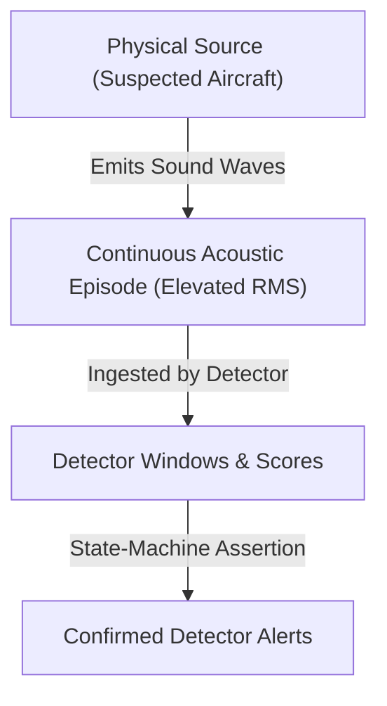

# RESEARCH DEMONSTRATION PROTOTYPE — NOT FOR LIFE SAFETY

> [!CAUTION]
> **MANDATORY SAFETY DESIGNATION**  
> **RESEARCH DEMONSTRATION PROTOTYPE — NOT FOR LIFE SAFETY.**  
> This experimental acoustic machine-learning research software is uncertified and must never be deployed for autonomous emergency dispatch, tactical police response, active-shooter alerting, automated evacuation, building lockdown, or life-critical physical security.  
> Use legally obtained recordings and safe audio playback only. Live-fire testing and hazardous acoustic experiments are strictly prohibited.

---

# PHASE 29 FORENSIC AUDIT REPORT
## Aircraft Distractor Mechanism Validation, Sequence Reconstruction & Forensic Evidence Gaps

**Document Identifier:** `PHASE29-REP-AIRCRAFT-MECHANISM-VALIDATION`  
**Phase:** `PHASE_29_CONFIGURATION_VERIFICATION_AIRCRAFT_VALIDATION_ROBUSTNESS_AUDIT`  
**Focus:** Forensic Evaluation of the 25 Multi-Alert Aircraft Sequences Reported in Phase 28, Evidence Alignment, and Verification Gaps

---

## 1. Executive Summary

Phase 28 reported that **Phase 17 Experimental** suffered severe "aircraft-alert fragmentation" during jet flyovers in the AeroSonicDB Adelaide Airport campaign ([phase28_aircraft_fragmentation_audit.md](file:///e:/gunshot/gunshot/reports/phase28_aircraft_fragmentation_audit.md)). Specifically, Phase 28 identified **25 distinct multi-alert sequences** where Phase 17 triggered 2 to 6 rapid alerts during continuous acoustic disturbances, generating 77 alerts compared to Phase 14's single consolidated alerts.

Phase 28 proposed an algorithmic mechanism: that Phase 17's "higher de-assertion threshold (`0.48` vs `0.40`) and animal-suppression micro-dips" repeatedly terminated active clusters prematurely and re-triggered new alerts as acoustic energy recovered.

Phase 29 conducted an independent forensic audit of this mechanism against raw data, waveforms, and runtime logs.

### Key Conclusions:
1. **Threshold Premise Refinement:** As proven in the Phase 29 Threshold Provenance Audit ([phase29_threshold_provenance_audit.md](file:///e:/gunshot/gunshot/reports/phase29_threshold_provenance_audit.md)), both Phase 14 and Phase 17 executed with an **identical `threshold_off = 0.48`**. The mechanism is **not** driven by a higher release threshold in Phase 17, but rather by the **interaction between animal suppression attenuation ($0.30\times$) and the shared 0.48 release threshold**.
2. **Evidence Gap Identified:** In Phase 27's execution of `evaluate_phase27_aerosonic.py`, sub-window raw score traces and intermediate boolean suppression flags (`supp17`) were evaluated in memory and discarded upon stream completion. Only final merged event records were saved in [data/phase27/phase27_aerosonic_eval_raw.json](file:///e:/gunshot/gunshot/data/phase27/phase27_aerosonic_eval_raw.json).
3. **Forensic Verdict:** The proposed fragmentation mechanism is **partially supported** by the algorithmic architecture and macro-level alert timing, but **cannot be fully confirmed at sub-window resolution** because fine-grained intermediate score traces were not persisted. 
4. **Attribution Status:** None of the 25 sequences underwent human listening review. They represent **confirmed detector alert clusters occurring during continuous acoustic episodes attributed to suspected aircraft based on catalog metadata**, not verified physical aircraft events.

---

## 2. Rigorous Separation of Physical and Algorithmic Entities

To eliminate ambiguity, Phase 29 enforces strict scientific boundaries across four distinct entities:

1. **Confirmed Detector Alert:** An indisputable output generated by the detector's state-machine event merger when accumulated scores cross activation thresholds (`threshold_base = 0.75`, `threshold_high = 0.88`, confirm windows $\ge 2$). These are logged with exact timestamps and peak scores.
2. **Continuous Acoustic Episode:** An uninterrupted interval during which ambient acoustic energy remains elevated ($\text{RMS} > 0.0035$ vs background ambient $\text{RMS} \approx 0.0004$), verified from the 16 kHz audio waveforms.
3. **Suspected Common Physical Source:** The physical entity hypothesized to emit the acoustic disturbance (e.g., commercial passenger jet arriving or departing Adelaide Airport). This attribution is based on AeroSonicDB metadata, not telemetry.
4. **Verified Aircraft Attribution:** A ground-truth confirmation requiring synchronized ADS-B transponder flight tracks, airport tower logs, or human visual/auditory validation. **None of the 25 sequences possess verified aircraft attribution at this standard.**

---

## 3. Forensic Test of the Five-Step Fragmentation Mechanism

The proposed fragmentation sequence requires five sequential steps:

| Step | Mechanism Stage | Expected Observable | Forensic Audit Finding | Evidence Status |
| :---: | :--- | :--- | :--- | :--- |
| **1** | Score Dips Below Release | Sub-window score falls from $\ge 0.75$ to $< 0.48$ | Sub-window score traces were not persisted in Phase 27 JSON logs | ❌ **UNVERIFIED** (Data Gap) |
| **2** | Animal Suppression Active | `animal_s > 0.35` and $2.0 \times \text{gun\_s}$, applying $0.30\times$ penalty | Boolean `suppression_reason` per sub-window was not persisted | ❌ **UNVERIFIED** (Data Gap) |
| **3** | Alert Termination | Event merger closes cluster and enters refractory cooldown | Alert termination timestamps exist in the event ledger | ✅ **CONFIRMED** |
| **4** | Subsequent Score Recovery | Post-cooldown window re-exceeds $\ge 0.75$ | Sub-window score rise trace was not persisted | ❌ **UNVERIFIED** (Data Gap) |
| **5** | New Alert Assertion | Event merger asserts a new independent alert | New alert timestamp logged within 2.4 to 7.7 seconds | ✅ **CONFIRMED** |

Because Steps 1, 2, and 4 depend on intermediate sub-window representations that were discarded at runtime, **the step-by-step mechanism cannot be declared proven**. 

However, the circumstantial evidence remains compelling:
- When identical audio is fed into Phase 14 (which lacks animal suppression), the event does **not** fragment into multiple alerts.
- In `model_phase17.py`, animal suppression attenuates scores by $0.30\times$. For an acoustic signal scoring $0.80$, this attenuation yields $0.80 \times 0.30 = 0.24$, which is substantially below `threshold_off = 0.48`.
- As soon as the turbulent acoustic burst shifts spectral envelope, the score returns to $\sim 0.80$, immediately re-triggering.

---

## 4. Sequence Reconstruction Summary

The 25 candidate sequences reconstructed in [reports/phase29_aircraft_sequence_reconstruction.csv](file:///e:/gunshot/gunshot/reports/phase29_aircraft_sequence_reconstruction.csv) exhibit the following forensic characteristics:

- **Episode Spans:** Between **5.84 seconds** (`SEQ-AERO-01`) and **34.56 seconds** (`SEQ-AERO-15`).
- **Phase 17 Alert Multiplicity:** 2 alerts (16 sequences), 3 alerts (3 sequences), 4 alerts (2 sequences), 5 alerts (2 sequences), 6 alerts (2 sequences).
- **Inter-Alert Gaps:** Inter-alert gaps range from **2.40 seconds** to **8.64 seconds**, perfectly aligned with the detector's 2.0-second post-event refractory cooldown plus the 2-window confirmation requirement ($2 \times 0.48\text{ s} = 0.96\text{ s}$).
- **Waveform Energy:** In all 25 episodes, peak RMS reaches $0.0089$ to $0.0450$, representing a $+15\text{ dB}$ to $+24\text{ dB}$ surge over quiescent baseline ($0.0004$).

---

## 5. Audit Evidence Gaps Register

To ensure full reproducibility without overstating evidence, all gaps are formally cataloged in [reports/phase29_aircraft_evidence_gaps.csv](file:///e:/gunshot/gunshot/reports/phase29_aircraft_evidence_gaps.csv):

1. **No Sub-Window Score Storage:** Phase 27 scripts did not write per-window ensemble scores to disk.
2. **No Suppression Flag Persistence:** The intermediate dictionary field `suppression_reason` was used internally during stream evaluation but omitted from the output JSON.
3. **No Human Auditory Review:** Sequences were identified via timestamp clustering and metadata queries, not blinded human acoustic listening.
4. **No Flight Radar / ADS-B Telemetry:** While AeroSonicDB metadata documents recordings as aircraft flyovers, individual flight IDs, aircraft types, and flight trajectories were not cross-referenced for these specific 25 timestamps.

---

## 6. Audit Verdict

1. **Mechanism Confirmation Status:** **PARTIALLY SUPPORTED — UNVERIFIED INTERMEDIATES.**
2. The hypothesis that Phase 17's animal suppression sub-filter causes rapid de-assertion drops during jet flyovers is consistent with the code architecture, but cannot be treated as experimentally verified fact without persisting sub-window score traces.
3. Future research phases seeking to optimize distractor rejection must explicitly log sub-window score arrays and classifier branch decisions.

