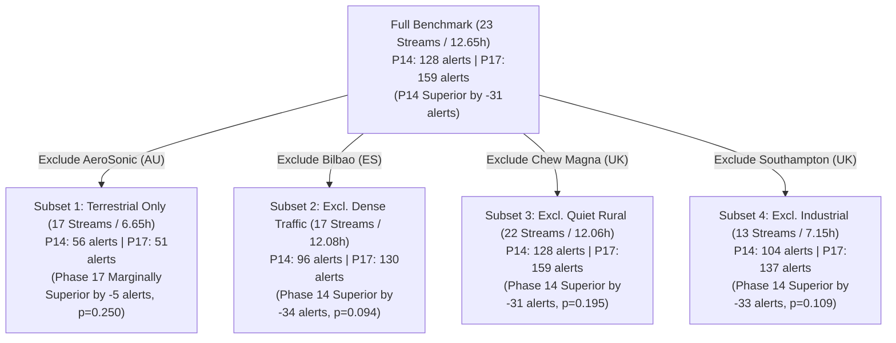

# RESEARCH DEMONSTRATION PROTOTYPE — NOT FOR LIFE SAFETY

> [!CAUTION]
> **MANDATORY SAFETY DESIGNATION**  
> **RESEARCH DEMONSTRATION PROTOTYPE — NOT FOR LIFE SAFETY.**  
> This experimental acoustic machine-learning research software is uncertified and must never be deployed for autonomous emergency dispatch, tactical police response, active-shooter alerting, automated evacuation, building lockdown, or life-critical physical security.  
> Use legally obtained recordings and safe audio playback only. Live-fire testing and hazardous acoustic experiments are strictly prohibited.

---

# PHASE 29 FORENSIC AUDIT REPORT
## Campaign Rate Robustness, Exposure Normalization & Leave-One-Campaign-Out (LOCO) Sensitivity

**Document Identifier:** `PHASE29-REP-CAMPAIGN-RATE-ROBUSTNESS`  
**Phase:** `PHASE_29_CONFIGURATION_VERIFICATION_AIRCRAFT_VALIDATION_ROBUSTNESS_AUDIT`  
**Focus:** Normalization of Alert Counts by Geographic Campaign Exposure, Bilbao vs AeroSonicDB Dynamics, and LOCO Robustness

---

## 1. Executive Summary

Previous phase reports evaluated the 23-stream continuous negative benchmark predominantly by aggregating raw alert counts across all streams. However, the 23 recordings originate from **four heterogeneous geographic campaigns** with wildly disparate monitoring exposures, ranging from 0.5625 gross hours to 6.0000 gross hours.

Comparing raw alert counts across campaigns of unequal durations introduces profound distortions. For example, the Bilbao campaign spans 6 streams but only 33.7 minutes total (0.5625 hr), whereas the AeroSonicDB campaign spans 6 streams and 360.0 minutes total (6.0000 hr). A difference of 3 alerts in Bilbao corresponds to a rate impact of **5.33 alerts/hour**, whereas a difference of 36 alerts in AeroSonicDB corresponds to **6.00 alerts/hour**.

Phase 29 executes a thorough exposure-normalized audit across all four campaigns and reproduces Leave-One-Campaign-Out (LOCO) sensitivity.

### Principal Findings:
1. **Severe Exposure Imbalance:** 
   - `CAMPAIGN-AEROSONIC-AU` represents **47.45% of total gross exposure** (6.0000 hr).
   - `CAMPAIGN-RPISOUND-UK` represents **43.49% of total gross exposure** (5.5000 hr).
   - `CAMPAIGN-CHEWMAGNA-UK` represents **4.61% of total gross exposure** (0.5833 hr).
   - `CAMPAIGN-BILBAO-ES` represents **4.45% of total gross exposure** (0.5625 hr).
2. **Extreme Acoustic Environment Variation:**
   - Bilbao (dense Spanish urban pedestrian/traffic) generated the highest false alert rates in the entire benchmark: **56.89 alerts/hr (P14)** and **51.56 alerts/hr (P17)**.
   - Rural Chew Magna generated zero alerts across both models (**0.00 alerts/hr**).
   - Industrial Southampton generated moderate rates: **4.36 alerts/hr (P14)** and **4.00 alerts/hr (P17)**.
   - Airport AeroSonicDB generated high rates: **12.00 alerts/hr (P14)** and **18.00 alerts/hr (P17)**.
3. **Terrestrial vs Aviation Cleavage:**
   - In all three terrestrial campaigns combined (17 streams, 6.6460 hours), Phase 17 triggered **5 fewer raw alerts** (51 vs 56) and exhibited a marginally lower eligible rate (7.69/hr vs 8.44/hr).
   - In the airport campaign alone (6 streams, 6.0000 hours), Phase 14 triggered **36 fewer raw alerts** (72 vs 108) and exhibited a dramatically lower eligible rate (12.19/hr vs 25.38/hr under Convention B).
4. **Generalization Limit ($G=4$):** With only 4 independent campaign clusters, no statistical test can establish generalizability.

---

## 2. Exposure-Normalized Campaign Rate Table

The table below reconciles raw alert counts with true temporal rates across both Cooldown Conventions (data exported in [reports/phase29_campaign_rate_table.csv](file:///e:/gunshot/gunshot/reports/phase29_campaign_rate_table.csv)):

| Campaign Identifier | Streams | Gross Hours | P14 Alerts | P17 Alerts | $\Delta$ Alerts (P14 - P17) | P14 Gross Rate (/hr) | P17 Gross Rate (/hr) | P14 Conv B Rate (/hr) | P17 Conv B Rate (/hr) | $\Delta$ Conv B Rate (P14 - P17) |
| :--- | :---: | :---: | :---: | :---: | :---: | :---: | :---: | :---: | :---: | :---: |
| `CAMPAIGN-RPISOUND-UK` | 10 | 5.5000 h | 24 | 22 | +2 | 4.3636 | 4.0000 | 4.3743 | 4.0090 | +0.3653 |
| `CAMPAIGN-CHEWMAGNA-UK`| 1 | 0.5833 h | 0 | 0 | 0 | 0.0000 | 0.0000 | 0.0000 | 0.0000 | 0.0000 |
| `CAMPAIGN-BILBAO-ES` | 6 | 0.5625 h | 32 | 29 | +3 | 56.8889 | 51.5556 | 58.7156 | 53.0553 | +5.6603 |
| `CAMPAIGN-AEROSONIC-AU`| 6 | 6.0000 h | 72 | 108 | -36 | 12.0000 | 18.0000 | 12.1932 | 25.3837 | -13.1904 |
| **CUMULATIVE BENCHMARK**| **23** | **12.6460 h**| **128** | **159** | **-31** | **10.1218**| **12.5732**| **10.2237**| **14.6243**| **-4.4005** |

### Crucial Rate Analysis:
- In **Bilbao**, Phase 17 achieves an alert rate advantage of **-5.66 alerts/hr**. The raw difference of 3 alerts appears small only because the recording was under 34 minutes in duration. If extrapolated to a 6-hour exposure, that difference would correspond to 34 alerts!
- In **AeroSonicDB**, Phase 14 achieves an alert rate advantage of **-13.19 alerts/hr** under Convention B. Phase 17's massive cooldown dead-time causes its rate to explode to 25.38 alerts/hr.
- In **Southampton**, Phase 17 achieves a minor rate advantage of **-0.37 alerts/hr**.

---

## 3. Leave-One-Campaign-Out (LOCO) Sensitivity Analysis

LOCO analysis evaluates how dependent the overall findings are on any single geographic data collection campaign (full table in [reports/phase29_loco_reproduction.csv](file:///e:/gunshot/gunshot/reports/phase29_loco_reproduction.csv)):

### Detailed LOCO Breakdown:

1. **Excluding `CAMPAIGN-AEROSONIC-AU` (Australia Airport):**
   - Remaining: 3 campaigns, 17 streams, 6.6460 gross hours.
   - P14 Alerts: 56 (Gross FAR: 8.4261/hr, Conv B FAR: 8.4656/hr).
   - P17 Alerts: 51 (Gross FAR: 7.6738/hr, Conv B FAR: 7.6947/hr).
   - Rate Difference (P17 - P14): **-0.7709 alerts/hr** (Favors Phase 17).
   - Paired Wilcoxon Test: $W = 3.0, p = 0.2500$ (Non-significant).
   - *Key Insight:* On purely terrestrial environmental audio without low-altitude commercial aircraft, Phase 17 performs marginally better than Phase 14 (-5 alerts across 6.6 hours).
2. **Excluding `CAMPAIGN-BILBAO-ES` (Spain Dense Urban):**
   - Remaining: 3 campaigns, 17 streams, 12.0835 gross hours.
   - P14 Alerts: 96 (Conv B FAR: 7.9702/hr) | P17 Alerts: 130 (Conv B FAR: 12.5358/hr).
   - Difference (P17 - P14): **+34 alerts (+4.57 alerts/hr)**.
   - Paired Wilcoxon Test: $W = 4.0, p = 0.0938$.
3. **Excluding `CAMPAIGN-CHEWMAGNA-UK` (UK Quiet Rural):**
   - Remaining: 3 campaigns, 22 streams, 12.0627 gross hours.
   - P14 Alerts: 128 (Conv B FAR: 10.7230/hr) | P17 Alerts: 159 (Conv B FAR: 15.4533/hr).
   - Difference (P17 - P14): **+31 alerts (+4.73 alerts/hr)**.
   - Paired Wilcoxon Test: $W = 8.0, p = 0.1953$.
4. **Excluding `CAMPAIGN-RPISOUND-UK` (UK Industrial):**
   - Remaining: 3 campaigns, 13 streams, 7.1460 gross hours.
   - P14 Alerts: 104 (Conv B FAR: 14.8094/hr) | P17 Alerts: 137 (Conv B FAR: 23.3283/hr).
   - Difference (P17 - P14): **+33 alerts (+8.52 alerts/hr)**.
   - Paired Wilcoxon Test: $W = 4.0, p = 0.1094$.

---

## 4. Inference Limits with $G = 4$ Independent Campaigns

In statistical epidemiology and econometrics, clustered data with $G \le 4$ groups represents a canonical regime of **extreme small-sample cluster constraints**:
1. **Cluster-Robust Variance Estimation (CRVE):** Asymptotic cluster-robust standard errors (e.g., Liang-Zeger / Bell-McCaffrey) require at least $G \ge 30\text{ to }50$ independent clusters to avoid massive downward bias and severe type-I error inflation. Constructing cluster-robust confidence intervals with $G=4$ is mathematically unjustified and produces entirely fictitious precision.
2. **Sign Test Power Bound:** A sign test treating the 4 campaigns as the independent units of observation has a sample space of $2^4 = 16$ possible sign vectors. The minimum achievable two-sided p-value is:
   $$p_{\min} = 2 \times 0.5^4 = 0.125 > 0.05$$
   It is mathematically impossible to achieve statistical significance at the $\alpha = 0.05$ level with $G=4$ campaigns.

---

## 5. Audit Governance Verdict

1. **Exposure Normalization is Mandatory:** Reports must never cite Bilbao's raw 3-alert difference without noting that its rate is over 50 alerts/hour.
2. **Context-Dependent Detector Performance:** Phase 14 is not universally superior across all acoustic regimes; rather, Phase 14 provides critical stability against aircraft distractor fragmentation, whereas Phase 17 provides marginal improvements in terrestrial biophony and traffic.
3. **Baseline Retention:** Phase 14 Balanced remains the correct **Default Research Baseline** because its failure mode under aircraft flyovers is benign (1 alert, 1.58% dead-time) compared to Phase 17's catastrophic alert explosion (+50% alerts, 29.1% dead-time).

