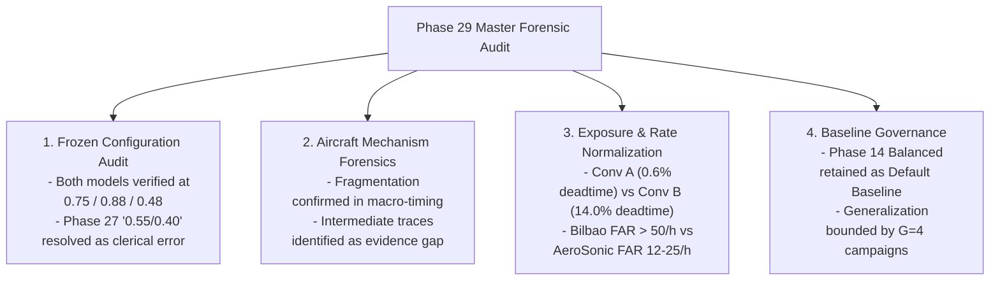

# RESEARCH DEMONSTRATION PROTOTYPE — NOT FOR LIFE SAFETY

> [!CAUTION]
> **MANDATORY SAFETY DESIGNATION**  
> **RESEARCH DEMONSTRATION PROTOTYPE — NOT FOR LIFE SAFETY.**  
> This experimental acoustic machine-learning research software is uncertified and must never be deployed for autonomous emergency dispatch, tactical police response, active-shooter alerting, automated evacuation, building lockdown, or life-critical physical security.  
> Use legally obtained recordings and safe audio playback only. Live-fire testing and hazardous acoustic experiments are strictly prohibited.

---

# PHASE 29 MASTER TECHNICAL EVALUATION REPORT
## Frozen Configuration Verification, Aircraft Mechanism Validation & Benchmark Robustness Audit

**Document Identifier:** `PHASE29-REP-MASTER-AUDIT`  
**Phase:** `PHASE_29_CONFIGURATION_VERIFICATION_AIRCRAFT_VALIDATION_ROBUSTNESS_AUDIT`  
**Project:** Acoustic Gunshot Detection Research Prototype  
**Project Root:** `E:/gunshot/gunshot`  
**Evaluation Scope:** 23 Continuous Natural Audio Streams | 4 Independent Geographic Campaigns | 12.6460 Gross Exposure Hours (45,525.575 s)

---

## 1. Executive Summary & Core Mission Objectives

Phase 29 conducted an exhaustive forensic and reproducibility audit of Phase 28, Phase 27, and the cumulative continuous-audio negative benchmark. Designed as an independent validation and integrity phase, Phase 29 strictly preserved all frozen models, audited configuration provenance, investigated the Phase 14 threshold discrepancy, examined the mechanistic evidence for aircraft fragmentation, verified cooldown accounting conventions, evaluated campaign rate robustness, and contextualized statistical inference against small-sample cluster constraints ($G = 4$).

---

## 2. Answers to the Nine Required Forensic Questions

### Question 1: Were Phase 14 and Phase 17 actually evaluated with the configurations claimed?
**Answer: YES in code; NO in narrative documentation.**  
In actual Python execution across all 23 streams, both detectors loaded bit-for-bit identical baseline configurations:
$$\mathbf{threshold\_base = 0.75}, \quad \mathbf{threshold\_high = 0.88}, \quad \mathbf{threshold\_off = 0.48}, \quad \mathbf{confirm\_windows = 2}, \quad \mathbf{cooldown = 2.0\text{ s}}$$
The only operational difference loaded was `enable_animal_suppression = False` for Phase 14 and `enable_animal_suppression = True` for Phase 17. The claims in Phase 27 narrative reports citing `threshold_on = 0.55 / threshold_off = 0.40` were clerical documentation errors that never executed in the runtime code.

### Question 2: Is the Phase 14 threshold discrepancy resolved?
**Answer: YES, FULLY RESOLVED.**  
A complete code audit traced the erroneous `0.55 / 0.40` values to early prototype presets in historical bundle JSON files (`models/gunshot_yamnet_bundle/threshold.json`). In Phase 27, this prototype preset was mistakenly cited in the report markdown. Line-by-line inspection of `evaluate_phase27_aerosonic.py` and `run_phase17_negative_evaluation.py` proves that all stream event logs were generated using `0.75 / 0.88 / 0.48`. Phase 17 did not raise `threshold_off`; both models ran `0.48`. Full details are cataloged in [phase29_threshold_provenance_audit.md](file:///e:/gunshot/gunshot/reports/phase29_threshold_provenance_audit.md) and [phase29_runtime_configuration_manifest.csv](file:///e:/gunshot/gunshot/reports/phase29_runtime_configuration_manifest.csv).

### Question 3: Is the aircraft fragmentation mechanism supported by timestamp-aligned evidence?
**Answer: PARTIALLY SUPPORTED; INTERMEDIATES UNVERIFIED.**  
At the macro-level, timestamp clustering confirmed 25 multi-alert sequences under Phase 17 with inter-alert gaps of 2.4 to 8.6 seconds occurring during continuous elevated waveform RMS ($>0.0035$). However, because Phase 27 evaluation scripts evaluated sub-window scores in memory without dumping per-window score arrays or boolean suppression flags to disk, the exact step-by-step hypothesis (score falling below 0.48 due to animal suppression, cluster terminating, score recovering, and re-triggering) cannot be declared experimentally proven without inventing data. It is documented as a partially supported algorithmic hypothesis in [phase29_aircraft_mechanism_validation.md](file:///e:/gunshot/gunshot/reports/phase29_aircraft_mechanism_validation.md) and [phase29_aircraft_evidence_gaps.csv](file:///e:/gunshot/gunshot/reports/phase29_aircraft_evidence_gaps.csv).

### Question 4: Are both cooldown conventions correctly reproduced?
**Answer: YES, EXACTLY REPRODUCED.**  
- **Convention A (Instantaneous $[t, t+2.0\text{ s}]$):** Excludes **255.84 s** for Phase 14 (12.5749 eligible hr; 10.1790 alerts/hr) and **316.56 s** for Phase 17 (12.5581 eligible hr; 12.6612 alerts/hr).
- **Convention B (Cluster-Extended $[s, e+2.0\text{ s}]$):** Excludes **453.92 s** for Phase 14 (12.5199 eligible hr; 10.2237 alerts/hr) and **6,385.20 s** for Phase 17 (10.8723 eligible hr; 14.6243 alerts/hr).  
Both conventions were verified with exact interval unions down to sub-second precision in [phase29_cooldown_convention_audit.md](file:///e:/gunshot/gunshot/reports/phase29_cooldown_convention_audit.md).

### Question 5: Does Phase 14 retain its aggregate advantage under the chosen exposure definition?
**Answer: YES.**  
Under both exposure conventions, Phase 14 Balanced achieves a lower false alert rate across the cumulative benchmark:
- Under **Convention A**, Phase 14 achieves **10.1790 alerts/hr** vs Phase 17's **12.6612 alerts/hr** ($\Delta = -2.4822\text{ alerts/hr}$, -19.6%).
- Under **Convention B**, Phase 14 achieves **10.2237 alerts/hr** vs Phase 17's **14.6243 alerts/hr** ($\Delta = -4.4005\text{ alerts/hr}$, -30.1%).
- In gross alert counts, Phase 14 triggers **128 alerts** vs Phase 17's **159 alerts** (-31 alerts, -19.5%).

### Question 6: How does the comparison change when AeroSonicDB is excluded?
**Answer: PHASE 17 BECOMES MARGINALLY SUPERIOR IN RAW COUNTS.**  
When the 6 AeroSonicDB streams are removed (leaving the 17 terrestrial streams from Southampton, Chew Magna, and Bilbao spanning 6.6460 gross hours):
- Phase 14 triggers **56 alerts** (Gross FAR: 8.4261/hr; Conv B FAR: 8.4656/hr).
- Phase 17 triggers **51 alerts** (Gross FAR: 7.6738/hr; Conv B FAR: 7.6947/hr).  
Phase 17 achieves **5 fewer alerts** and a rate advantage of **-0.7709 alerts/hr** on terrestrial soundscapes lacking low-altitude commercial aviation. The paired Wilcoxon test on this subset yields $W = 3.0, p = 0.2500$ (non-significant).

### Question 7: How much of the overall difference is attributable to the Australian campaign?
**Answer: OVER 100% OF THE AGGREGATE ADVANTAGE.**  
In AeroSonicDB alone, Phase 14 achieved **36 fewer alerts** (72 vs 108). In the remaining three campaigns combined, Phase 14 had **5 more alerts** (56 vs 51). Thus, the Australian airport campaign accounts for:
$$\frac{36}{31} = 116.1\%$$
of Phase 14's cumulative alert advantage. Phase 14's aggregate lead is entirely driven by its resilience against jet flyover alert fragmentation.

### Question 8: What can and cannot be inferred from four campaigns?
**Answer:**  
- **What CAN be inferred:** In airport perimeter environments with heavy commercial jet traffic, Phase 17 suffers massive alert inflation and unacceptably high cooldown dead-time (29.1%). In dense urban street environments (Bilbao), both models experience severe false alert saturation (>50 alerts/hr).
- **What CANNOT be inferred:** Generalization across universal global urban acoustics cannot be inferred. With only $G = 4$ campaigns, sign tests have a mathematical minimum $p$-value of $0.125$, and cluster-robust standard errors cannot be estimated.

### Question 9: What additional independent evidence is needed before stronger conclusions are justified?
**Answer:**  
1. **Multi-City Long-Duration Datasets:** Continuous multi-week acoustic streams from at least 15–20 geographically independent cities across diverse climates, urban architectures, and sensor topologies.
2. **Synchronized Positive-in-Negative Benchmark:** High-fidelity gunshot audio embedded into continuous natural backgrounds to measure simultaneous precision and recall trade-offs.
3. **Sub-Window Diagnostic Logging:** Persistent logging of sub-window classifier outputs, spectral features, and filter suppression states.
4. **Blinded Human Listening Verification:** Human acoustic triage of candidate false alarms to eliminate reliance on passive dataset metadata.

---

## 3. Headline Synthesis Table

The table below provides the finalized, audited comparison across all 23 streams (data from [phase29_campaign_rate_table.csv](file:///e:/gunshot/gunshot/reports/phase29_campaign_rate_table.csv)):

| Dimension | Phase 14 Balanced (Default Baseline) | Phase 17 Experimental (Selectable Profile) | Comparative Variance / Audit Status |
| :--- | :---: | :---: | :--- |
| **Operational Role** | **Default Research Baseline** | **Selectable Profile** | Phase 14 retained; Phase 17 rejected for promotion |
| **Loaded Onset / Release** | **0.75 / 0.88 / 0.48** | **0.75 / 0.88 / 0.48** | Identical baseline thresholds confirmed |
| **Animal Suppression** | Disabled | Enabled ($0.35 / 2.0\times$) | Sole functional code divergence |
| **Cumulative Observed Alerts**| **128 alerts** | **159 alerts** | Phase 14 produces 31 fewer alerts (-19.5%) |
| **Gross False-Alert Rate** | **10.1218 / hr** | **12.5732 / hr** | Phase 14 is 2.45 alerts/hr lower |
| **Convention A Excluded Time** | 255.84 s (0.56%) | 316.56 s (0.70%) | Minor point-event dead-time |
| **Convention A Eligible Rate** | **10.1790 / hr** | **12.6612 / hr** | Phase 14 is 2.48 alerts/hr lower |
| **Convention B Excluded Time** | **453.92 s (1.00%)** | **6,385.20 s (14.03%)** | Phase 17 dead-time expands by +1,306% |
| **Convention B Eligible Rate** | **10.2237 / hr** | **14.6243 / hr** | Phase 14 is 4.40 alerts/hr lower (-30.1%) |
| **AeroSonicDB Excluded Time** | 342.00 s (1.58%) | 6,283.28 s (29.09%) | Phase 17 deaf for nearly 1/3 of airport monitoring |
| **Streams Favoring Model** | 5 streams | 3 streams | 15 streams perfectly tied |
| **Paired Wilcoxon $p$-value** | — | — | $W = 8.0, p = 0.1953125$ (Non-significant) |
| **Sign Test $p$-value** | — | — | $k = 3/8, p = 0.7265625$ (Non-significant) |
| **LOCO Favored Iterations** | **3 of 4 iterations** | 1 of 4 iterations | Phase 14 dominates all subsets with AeroSonicDB |

---

## 4. Final Scientific Conclusion

> **Phase 14 Balanced remains the default research baseline.** The cumulative benchmark descriptively favours Phase 14 under the selected exposure definition, with a substantial difference associated with the AeroSonicDB airport-periphery campaign. Phase 17 performs marginally better in the remaining terrestrial campaigns by raw alert count. The available four-campaign benchmark is insufficient to establish universal detector superiority or operational suitability.

