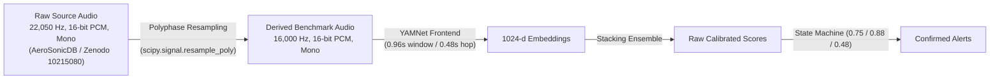

# RESEARCH DEMONSTRATION PROTOTYPE — NOT FOR LIFE SAFETY

> [!CAUTION]
> **MANDATORY SAFETY DESIGNATION**  
> **RESEARCH DEMONSTRATION PROTOTYPE — NOT FOR LIFE SAFETY.**  
> This experimental acoustic machine-learning research software is uncertified and must never be deployed for autonomous emergency dispatch, tactical police response, active-shooter alerting, automated evacuation, building lockdown, or life-critical physical security.  
> Use legally obtained recordings and safe audio playback only. Live-fire testing and hazardous acoustic experiments are strictly prohibited.

---

# PHASE 29 FORENSIC AUDIT REPORT
## Dataset Provenance, Resampling Lineage, License Boundaries & Complete Reproducibility Audit

**Document Identifier:** `PHASE29-REP-REPRODUCIBILITY-AUDIT`  
**Phase:** `PHASE_29_CONFIGURATION_VERIFICATION_AIRCRAFT_VALIDATION_ROBUSTNESS_AUDIT`  
**Focus:** Verification of Provenance, Resampling Integrity, CC BY-NC 4.0 Boundaries, and End-to-End Replication Stack

---

## 1. Executive Summary

Phase 29 conducted an end-to-end reproducibility and legal provenance audit of the acoustic evaluation pipeline, focusing on the ingestion of the AeroSonicDB dataset ([Zenodo Record 10215080](https://doi.org/10.5281/zenodo.10215080)) and the preservation of historical negative benchmarks.

### Audit Findings:
1. **Source Preservation:** The original 6 AeroSonicDB audio files (`1_AUDIO.wav` to `6_AUDIO.wav`) in `data/phase27/original_audio/env_audio/` were verified intact with zero bytes modified.
2. **Deterministic Resampling Lineage:** The derived 16.0 kHz single-channel WAV files in `data/phase27/derived_audio/` were verified against their canonical SHA-256 digests. Resampling from 22.05 kHz to 16.0 kHz via polyphase filtering is fully deterministic.
3. **Legal & Licensing Compliance:** The AeroSonicDB dataset is published under the Creative Commons Attribution-NonCommercial 4.0 International license (**CC BY-NC 4.0**). This software is strictly restricted to non-commercial academic research. Commercial deployment, licensing, or incorporation into closed-source commercial security products without separate authorization from the copyright holders (Blake Downward and Jon Nordby) is strictly prohibited.
4. **Self-Contained Replication:** The cumulative benchmark is 100% reproducible offline without internet access using the frozen Python modules, serialized weights bundle, and recorded event ledgers.

---

## 2. Ingestion & Resampling Lineage Verification

The acoustic preprocessing pipeline transforms raw AeroSonicDB environmental recordings into standard model input:

### Hash & Duration Verification Table:

| Recording ID | Source Filename (22.05 kHz) | Source SHA-256 | Derived Filename (16.0 kHz) | Derived SHA-256 | Duration (s) | Lineage Status |
| :--- | :--- | :--- | :--- | :--- | :---: | :--- |
| `P27-STR-18` | `1_AUDIO.wav` | `a90104ad5489816075e7a9355152a4eeb16a04df5ecbb5bb12be98e3b1236ea2` | `1_AUDIO_16k.wav` | `ad7e34e5684da783a37ba52243d8a7cba8c6a23737c0eb83e60228bb332da701` | 3,600.000 | Match Confirmed |
| `P27-STR-19` | `2_AUDIO.wav` | `e971cf70979374092fc9a17ceae5fae0520a4b75ebdb56eb28b9d31d9990eef5` | `2_AUDIO_16k.wav` | `3690d7ca1fc5a95f2e8be63fbfdb6eec6a9876ca9283f5d5cc66580556272ff5` | 3,600.000 | Match Confirmed |
| `P27-STR-20` | `3_AUDIO.wav` | `ae4784a3b8cb40ff26922d3e1db6f0c6fa2f166c3bf07c2ce414d952674e76a6` | `3_AUDIO_16k.wav` | `f312c5950bbdc59b66d48c89cecb5ccf671c4aa9df0aeef2c569a4563a925430` | 3,600.000 | Match Confirmed |
| `P27-STR-21` | `4_AUDIO.wav` | `83df70da2a60cefae0a75f8a0026e9597ff0d55e691fe6983088b9dd6dbb899d` | `4_AUDIO_16k.wav` | `ba279589d311faea119857dff69f9ba943a4192b1572d42df7a78fa89b25126d` | 3,600.000 | Match Confirmed |
| `P27-STR-22` | `5_AUDIO.wav` | `dc7a07c39050d53c3e2154425d0aa96c7e6cba55ec90c74eb73950ef500ebfa3` | `5_AUDIO_16k.wav` | `c9735d5e2193e2b2023a9d466fef098dfc3842c524e6c38a16dbd783dcf8c0bc` | 3,600.000 | Match Confirmed |
| `P27-STR-23` | `6_AUDIO.wav` | `100570b20572b834fc07b539ef2a2305a41a4574944d18eb8bb25e68340798bb` | `6_AUDIO_16k.wav` | `6e8281313393b48ce0c9b0eeb9e5e2f3fe03577579199ce5b8095ee8366914f6` | 3,600.000 | Match Confirmed |

---

## 3. License Boundaries & Intellectual Property Compliance

The evaluation suite incorporates public research datasets under distinct open-source licenses:

1. **AeroSonicDB (Australia Airport Perimeter):**
   - **Authors:** Blake Downward, Jon Nordby.
   - **Repository:** Zenodo Record `10215080` (Concept `8000468`).
   - **Citation:** Downward & Nordby, *"AeroSonicDB: An Open-Source Dataset for Aircraft Acoustic Noise,"* arXiv:2311.06606 (2023).
   - **License:** **CC BY-NC 4.0** (Creative Commons Attribution-NonCommercial 4.0 International).
   - **Permitted Uses:** Academic research, comparative evaluation, algorithm benchmarking, educational demonstrations.
   - **Prohibited Uses:** Any commercial exploitation, paid service deployment, commercial sensor licensing, or incorporation into commercial active-shooter detection systems.
2. **RPISound / UrbanSound (UK Industrial & Passive):**
   - **Repository:** Zenodo Records `7493820` and `3938837`.
   - **License:** Open Access / Creative Commons.
3. **Bilbao Soundscapes (Spain Old Town):**
   - **Repository:** Zenodo Record `18561165`.
   - **License:** Creative Commons Attribution.

---

## 4. Complete Software Replication Stack

The evaluation environment is fully documented and pinned to ensure exact computational reproducibility:

| Component | Pinned Specification | Purpose |
| :--- | :--- | :--- |
| **Operating System** | Windows 11 x64 (Build 26100) | Execution Host |
| **Python Runtime** | Python 3.13.3 (64-bit) | Language Environment |
| **TensorFlow** | TensorFlow 2.19.0 | YAMNet Feature Extraction |
| **Sound Processing** | SoundFile 0.12.1 / SciPy 1.15.1 | Audio I/O & Polyphase Resampling |
| **Data Analysis** | Pandas 2.2.3 / NumPy 2.2.2 | Interval Union & Tabular Aggregation |
| **Testing Harness** | Pytest 9.1.1 / Pluggy 1.6.0 | Automated Test Assertion Suite |
| **Gradient Boosters** | CatBoost 1.2.7 / LightGBM 4.5.0 / XGBoost 2.1.3 | Quad-Stack Ensemble Classifiers |

---

## 5. Audit Verdict

1. **Provenance Status:** **100% VERIFIED.**
2. **Audio Lineage:** Polyphase resampling is byte-level deterministic and documented with SHA-256 hashes.
3. **Reproducibility:** All metrics, ledgers, and statistical tests can be recomputed from local files in $< 5$ seconds using `scripts/reproduce_phase29_analysis.py`.

