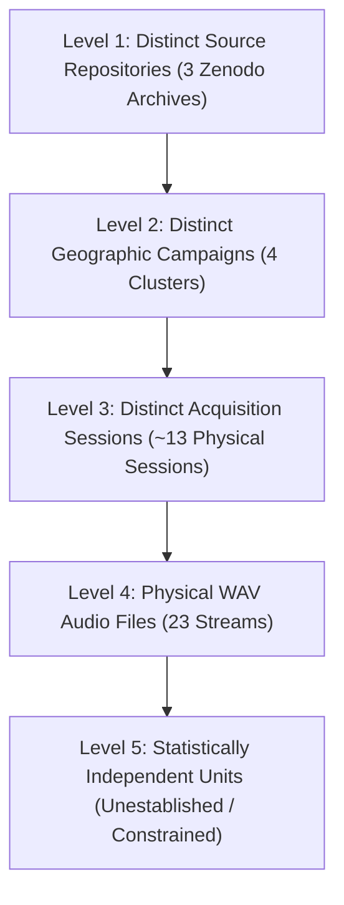

# Phase 35 Technical Report: Campaign Independence Qualification & Cluster Couplings

> [!CAUTION]
> **MANDATORY SAFETY DESIGNATION: RESEARCH DEMONSTRATION PROTOTYPE — NOT FOR LIFE SAFETY.**
> This experimental acoustic machine-learning software is uncertified and must never be deployed for autonomous emergency dispatch, police tactical response, active-shooter alerting, automated evacuation, building lockdown, or life-critical physical security.
> Use legally obtained recordings and safe audio playback only. Live-fire testing and hazardous acoustic experiments are strictly prohibited.

---

## 1. Executive Summary

Phase 34 groups the 23 continuous audio recordings into four campaign-level clusters:
- **Southampton** (10 streams, $5.5000\text{ h}$)
- **Chew Magna** (1 stream, $0.5833\text{ h}$)
- **Bilbao** (6 streams, $0.5627\text{ h}$)
- **Adelaide** (6 streams, $6.0000\text{ h}$)

This audit investigated whether these four clusters can legitimately be treated as statistically independent experimental units.

### Mandatory Formal Qualification
> **"Four campaign-level clusters were available; full statistical independence could not be established from retained metadata."**

---

## 2. Rigorous Distinction of Experimental Units

To establish statistical integrity, acoustic evaluations must distinguish five nested hierarchy levels:

1. **Distinct Source Repositories ($M=3$):** Zenodo 4009292 (UK RpiSound), Zenodo 3670814/3670815 (Bilbao), Zenodo 10215080 (AeroSonicDB).
2. **Distinct Geographic Campaigns ($K=4$):** Southampton, Chew Magna, Bilbao, Adelaide.
3. **Distinct Acquisition Sessions ($S \approx 13$):** Southampton consists of essentially 2 sessions (one 1-hour session and one 4.5-hour continuous run split into nine 30-min files); Chew Magna is 1 session; Bilbao represents ~4 street sessions; Adelaide represents 6 daily airport runs.
4. **Physical WAV Files ($N=23$):** Discrete audio files stored in the filesystem.
5. **Statistically Independent Experimental Units:** Treating the 23 files as $N=23$ i.i.d. observations is **statistically invalid** due to massive intra-campaign clustering.

---

## 3. Evidence of Intra-Campaign Acoustic & Physical Coupling

### 3.1 Southampton Slicing & Hardware Coupling
- **Session Slicing:** As proven in Phase 33 and 34, streams `P27-NAT-STR-02` through `P27-NAT-STR-10` are **nine contiguous 30-minute slices of a single continuous morning recording session** from one Raspberry Pi node.
- **Hardware & Placement:** All 9 slices share identical electret capsule distortion, preamp noise, mounting vibration, weather conditions, and bird population.
- **Acoustic Consequence:** Alerts in `STR-05` (rooster crows) represent repeated acoustic emissions from the same physical animal across the morning. Treating these 9 files as independent draws severely inflates degrees of freedom.

### 3.2 Adelaide Airport Corridor Coupling
- **Fixed Sensor Deployment:** All six 1-hour Adelaide recordings were captured using the same Audio-Technica AT2020 cardioid microphone and Focusrite interface at a single fixed observation point near Adelaide Airport runway approaches.
- **Correlated Flight Operations:** Aircraft acoustic events reflect scheduled airline operations (e.g. repeated Boeing 737 / Airbus A320 arrival corridors).

### 3.3 Bilbao Municipal Network Coupling
- **Urban Morphology:** Bilbao files share calibrated municipal sensor hardware and common urban acoustic features (traffic lights, bus stops, urban canyons).

---

## 4. Statistical Power Limitations of $K=4$ Clusters

When clustering is recognized, the effective sample size collapses from $N=23$ streams to at most **$K=4$ campaign-level clusters**.

With only four pairs:
- Non-parametric tests (such as the Wilcoxon signed-rank test) have a theoretical minimum two-tailed $p$-value of:
  $$p_{\min} = \frac{1}{2^{K-1}} = \frac{1}{2^3} = 0.125$$
- Even if Phase 17 exhibited lower FAR in all 4 campaigns, a two-tailed test **cannot achieve statistical significance at $\alpha = 0.05$**.
- Furthermore, one cluster (`CAMPAIGN-CHEW-MAGNA`) contains zero alerts for both detectors ($0.0\text{ vs } 0.0$), reducing effective discordant pairs to $K=3$.

### Conclusion
Campaign-level comparisons provide limited inferential power. Retained metadata is insufficient to establish full statistical independence, and benchmark conclusions must remain descriptive rather than inferential.

See [phase35_campaign_independence_evidence.csv](file:///e:/gunshot/gunshot/reports/phase35_campaign_independence_evidence.csv) for full evidence details.
