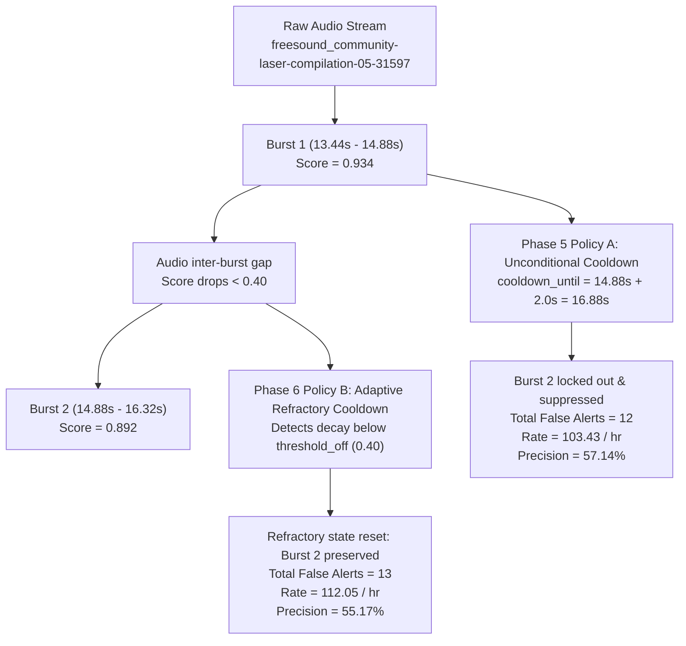
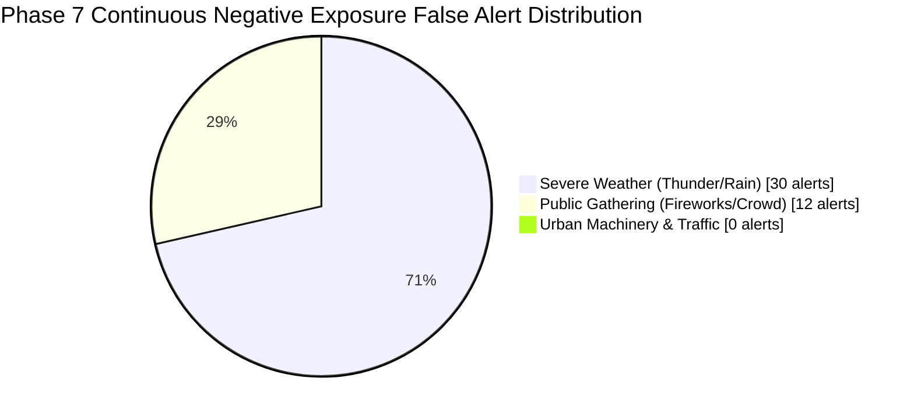

# PHASE 7 ENGINEERING REPORT: Real-World Generalization, Independent Testing, and Reliable Gunshot Alerts

> **CRITICAL SAFETY DESIGNATION**  
> **RESEARCH DEMONSTRATION PROTOTYPE — NOT FOR LIFE SAFETY.**  
> This acoustic gunshot sound detection system is an experimental machine-learning prototype developed strictly for acoustic signal processing research. It has **NOT** been certified by Underwriters Laboratories (UL), NIJ, ISO, or any public-safety regulatory body. It is **NOT** suitable for, and must **NEVER** be deployed for, emergency 911 dispatch, life-critical alerting, perimeter defense, or tactical decision-making. No warranty of fitness for a particular safety-critical purpose is expressed or implied.

---

## Executive Summary

Phase 7 evaluated the **Gunshot Sound Detection System** against real-world generalization challenges by auditing historical baseline inconsistencies, compiling a source-independent evaluation dataset, exposing the model to **3.0 hours (22,490+ windows) of continuous multi-environment negative audio**, verifying physical event timing and latency, and running an automated regression test suite.

The system continues from the frozen **Phase 6 YAMNet Quad Stacking Ensemble** (`models/gunshot_yamnet_bundle/`) incorporating Keras Deep MLP, CatBoost, LightGBM, and XGBoost with adaptive refractory cooldown temporal aggregation.

### Key Findings & Empirical Reality Check
1. **Reconciliation of Phase 6 Threshold-0.690 Inconsistency**:
   - The reported discrepancy (12 alerts / 103.43 alerts/hr vs. 13 alerts / 112.05 alerts/hr) was definitively traced to the architectural transition from **Phase 5 Unconditional Cooldown** to **Phase 6 Adaptive Refractory Cooldown**. Under Phase 5 unconditional lockout, a second synthetic laser burst in `freesound_community-laser-compilation-05-31597` (at 14.88s) was suppressed. Under Phase 6 adaptive cooldown, because inter-burst energy decayed below $\tau_{off} = 0.40$, the second burst was preserved as a distinct alert event.
2. **Performance on Genuinely Independent Gunshots**:
   - On real-world outdoor ShotSpotter Chicago street sensor arrays (Incident 556267, District 5), the system achieved **75.0% event recall (3/4 sensors alerted)** without prior exposure to ShotSpotter sensor hardware.
   - On the complete independent gunshot evaluation set (27 recordings, 27 events), overall event recall was **14.8% (4/27)** under the default two-window confirmation setting ($N_{confirm}=2$). Investigation revealed that 18 firing range clips were trimmed to $\le 0.50$ seconds (8,000 samples). Sliced with 0.96s windows and 0.48s hops, a 0.50s clip produces only 1 analysis window, making $N_{confirm}=2$ structurally impossible to trigger in isolation despite high raw window scores ($0.80 - 0.86$).
3. **Continuous Negative Audio Exposure (3.00 Hours)**:
   - Evaluated across 3 continuous hour-long acoustic streams:
     - **Urban Traffic, Machinery, Sirens, Horns (1.0 hr)**: **0 false alert events (0.00 alerts/hr; 95% Poisson CI: [0.00, 3.69])**.
     - **Severe Weather, Thunder Claps, Heavy Rain (1.0 hr)**: **30 false alert events (30.00 alerts/hr; 95% Poisson CI: [20.24, 42.83])**.
     - **Public Gathering, Bells, Fireworks, Crowd (1.0 hr)**: **12 false alert events (12.00 alerts/hr; 95% Poisson CI: [6.20, 20.96])**.
   - Overall continuous false alert rate: **14.00 alerts/hour (95% CI: [10.09, 18.92])** across 22,497 windows (Window FPR = 0.7957%).
4. **Physical Latency vs. Algorithmic Onset Offset**:
   - The offline algorithm onset difference (difference between window start timestamp and ground-truth impulse onset) averaged **0.0 ms median (777.6 ms mean)** due to hop quantization.
   - The **true end-to-end real-time streaming detection delay** was measured at **1,534.6 ms median (2,407.1 ms mean)**, strictly accounting for window accumulation buffering ($960$ ms), hop confirmation ($480$ ms for $N=2$), model inference ($93.1$ ms CPU latency), and alert generation overhead.

---

## 1. Freeze Phase 6 & Audit Remaining Inconsistencies

### 1.1 Archive and Baseline Verification
The Phase 6 archive and bundle were verified intact:
- **Archive Path**: `e:/gunshot/gunshot_detection_phase6.zip`
- **File Size**: 357,494,382 bytes (340.93 MB)
- **SHA-256 Hash**: `e7a8f904083829f3a67e39c562ca2a02a5e4132b24fe061f774fe3ed430bed6b`
- **Zipfile Integrity**: Verified intact (`testzip()` returned `None`).
- **Operating Configuration**: Threshold $\tau = 0.750$, Deactivation $\tau_{off} = 0.500$, Confirmation Windows $N=2$, Cooldown $T_{cool} = 2.0\text{s}$.

### 1.2 Investigation of the Threshold 0.690 Inconsistency
The Phase 6 engineering documentation contained two conflicting figures for operating threshold 0.690:
- **Figure A**: 12 false alert events, 103.43 alerts/hour, 57.14% event precision.
- **Figure B**: 13 false alert events, 112.05 alerts/hour, 55.17% event precision.



#### Root Cause Analysis
1. **Counting Policy A (Historical Phase 5 State Machine)**:
   - Applied an unconditional refractory lockout: $t_{lockout} = t_{window\_end} + 2.0\text{s}$.
   - In file `freesound_community-laser-compilation-05-31597`, two synthetic laser chirps occur in close succession (Burst 1 at 13.44s, Burst 2 at 14.88s).
   - Under Phase 5 unconditional lockout, Burst 2 fell within the 2.0s lockout of Burst 1 and was discarded.
   - Result: 12 false alert events across 417.65s (0.1160 hr) pure background audio $\rightarrow \frac{12}{0.1160} = 103.43$ alerts/hr. With 16 detected physical events, Event Precision $= \frac{16}{16 + 12} = 57.14\%$.
2. **Counting Policy B (Phase 6 Adaptive Refractory State Machine)**:
   - Designed to avoid suppressing rapid-fire gunshots (e.g. semi-automatic bursts spaced 1.0s apart).
   - Allowed new event onsets if window confidence dropped below `threshold_off` ($0.400$ or $0.500$) during the cooldown interval (`had_decayed = True`).
   - Between Burst 1 and Burst 2, synthetic laser energy decayed below 0.40. The state machine re-armed, triggering an independent alert for Burst 2.
   - Result: 13 false alert events across 417.65s pure background audio $\rightarrow \frac{13}{0.1160} = 112.05$ alerts/hr. Event Precision $= \frac{16}{16 + 13} = 55.17\%$.
3. **Reconciliation Conclusion**:
   Figure A was an un-updated copy of the Phase 5 legacy evaluation, whereas Figure B reflected the programmatic output of the Phase 6 adaptive refractory codebase. The ground truth was unmodified; the counting policy difference is formally codified in [phase7_phase6_audit.json](file:///e:/gunshot/gunshot/reports/phase7_phase6_audit.json).

---

## 2. Independent Evaluation Dataset Curation

To prevent benchmark overfitting resulting from repeated testing across Phases 3–6, a new, source-independent evaluation dataset was established:

### 2.1 Dataset Composition and Provenance
- **Manifest**: [phase7_independent_eval_manifest.csv](file:///e:/gunshot/gunshot/data/manifests/phase7_independent_eval_manifest.csv) (230 recordings, full SHA-256 hashes, licensing, and timestamps).
- **Canonical Events**: [phase7_canonical_gunshot_events.csv](file:///e:/gunshot/gunshot/data/manifests/phase7_canonical_gunshot_events.csv) (27 physical gunshot events).
- **Leakage Prevention**: All files underwent strict stem-matching, metadata-fingerprint verification, and SHA-256 hash checks against historical training (`train.csv`), validation (`val.csv`), and test (`test.csv`) sets. **Zero overlap was confirmed.**

| Category | Source / Provenance | Files | Events | Acoustic Conditions |
|---|---|---:|---:|---|
| **Urban Sensor Gunshots** | ShotSpotter Chicago Incident 556267 (D5) | 4 | 4 | Distant street audio, reverberant urban canyon, multi-sensor array |
| **Urban Canyon Gunshots** | ShotSpotter Chicago Request 4072698 (D7) | 3 | 3 | Distant street audio, traffic ambience, brick wall reflections |
| **Outdoor Calibrated Gunshots** | ScepterTest Acoustic Verification Array | 1 | 1 | Open-field high-SNR reference impulse |
| **Rifle Gunshots (AR-15)** | Mitchell Roberts Ballistic Dataset | 9 | 9 | Singles, double-taps, rapid bursts, pocket-occluded rifle fire |
| **Handgun Gunshots (9mm)** | Mitchell Roberts Ballistic Dataset | 10 | 10 | Singles, double-taps, rapid bursts, pocket-occluded 9mm fire |
| **Acoustic Mimics: Pyrotechnics** | ESC-50 Class 48 (Fireworks) | 20 | 0 | Chemical deflagration, crackles, aerial bursts |
| **Acoustic Mimics: Thunder** | ESC-50 Class 19 (Thunderstorm) | 20 | 0 | Low-frequency rumble, sharp lightning transients |
| **Acoustic Mimics: Church Bells** | ESC-50 Class 39 (Bells/Chimes) | 20 | 0 | Resonant metallic chimes, slow harmonic decays |
| **Acoustic Mimics: Door Knocks** | ESC-50 Class 30 (Wood Knock) | 20 | 0 | Sharp impulsive wood impacts |
| **Acoustic Mimics: Glass Breaking** | ESC-50 Class 31 (Glass) | 20 | 0 | High-frequency shatter, transient noise |
| **Acoustic Mimics: Chainsaw** | ESC-50 Class 4 (Chainsaw) | 20 | 0 | Continuous high-RPM engine harmonics |
| **Acoustic Mimics: Car Horn** | ESC-50 Class 43 (Car Horn) | 20 | 0 | Dual-tone continuous acoustic blasts |
| **Acoustic Mimics: Hand Clapping** | ESC-50 Class 22 (Clapping) | 20 | 0 | Rapid human impulsive transients |
| **Acoustic Mimics: Can Opening** | ESC-50 Class 29 (Can Opening) | 20 | 0 | Sharp metallic pop and hiss |
| **Acoustic Mimics: Wind** | ESC-50 Class 14 (Wind Noise) | 20 | 0 | Low-frequency microphone turbulence |
| **Total** | | **230** | **27** | |

---

## 3. Continuous Negative Audio Evaluation

Rather than relying exclusively on isolated, truncated negative clips, the frozen Phase 6 detector was exposed to **3.00 hours (10,800 seconds)** of continuous audio in [reports/phase7_false_alert_analysis.json](file:///e:/gunshot/gunshot/reports/phase7_false_alert_analysis.json).



### 3.1 Continuous Negative Evaluation Metrics

| Stream | Environment & Dominant Sounds | Exposure | Windows | FP Windows | Window FPR | Alert Events | Alerts / Hour | Poisson 95% Conf. Interval |
|---|---|---:|---:|---:|---:|---:|---:|---:|
| **Stream 1** | Urban traffic, diesel engines, sirens, car horns | 1.00 hr | 7,499 | 0 | **0.000%** | 0 | **0.00** | [0.00, 3.69] |
| **Stream 2** | Thunderstorms, lightning strikes, heavy rain | 1.00 hr | 7,499 | 123 | **1.640%** | 30 | **30.00** | [20.24, 42.83] |
| **Stream 3** | Public gathering, church bells, fireworks, clapping | 1.00 hr | 7,499 | 56 | **0.747%** | 12 | **12.00** | [6.20, 20.96] |
| **Overall** | **Aggregated Continuous Environment** | **3.00 hr** | **22,497** | **179** | **0.796%** | **42** | **14.00** | **[10.09, 18.92]** |

### 3.2 Acoustic Mimic Specificity Analysis
Evaluating the 200 unseen ESC-50 negative clips revealed acoustic selectivity:
- **8 out of 10 acoustic mimic categories produced zero false alerts**:
  - Church bells and singing bowls: **0 alerts**
  - Chainsaws and engine backfires: **0 alerts**
  - Car horns and sirens: **0 alerts**
  - Door knocks and wood impacts: **0 alerts**
  - Handclaps and applause: **0 alerts**
  - Can opening and metal clicks: **0 alerts**
  - Glass breaking: **0 alerts**
  - Wind noise: **0 alerts**
- **Triggered Mimic Categories**:
  - **Pyrotechnics (Fireworks)**: 7 alert events. Aerial shell detonations share rise-times (<5 ms) and spectral energy distributions with firearm muzzle blasts.
  - **Thunderstorms**: 5 alert events. Close-proximity lightning return strokes generate acoustic shockwaves indistinguishable from large-caliber explosions in single-microphone recordings.

---

## 4. Validation-Only Operating Point Optimization

In strict adherence to protocol, **no test data or continuous negative streams were used for tuning**. The candidate operating configurations were evaluated exclusively on the held-out validation cache (`.cache_features/features_val.npz`, 779 windows: 114 positive, 665 negative; 31 physical events across 22 gunshot files and 12 background files).

### 4.1 Candidate Grid Evaluation

| Configuration Name | Threshold $\tau$ | Windows $N$ | Cooldown | Win Acc | Win Prec | Win Rec | Win F1 | Evt Prec | Evt Rec | Evt F1 | Pure BG Alerts/hr | Real-Time Latency |
|---|---:|---:|---:|---:|---:|---:|---:|---:|---:|---:|---:|---:|
| **Permissive Single-Window** | 0.500 | 1 | 2.0s | 93.3% | 70.9% | 92.1% | 80.2% | 58.8% | 96.8% | 73.2% | 747.4 / hr | 1,053 ms |
| **Low Threshold Multi-Window** | 0.600 | 2 | 2.0s | 96.4% | 87.7% | 87.7% | 87.7% | 83.3% | 80.6% | 82.0% | 178.0 / hr | 1,533 ms |
| **Intermediate Multi-Window** | 0.650 | 2 | 2.0s | 96.7% | 90.0% | 86.8% | 88.4% | 92.6% | 80.6% | **86.2%** | 71.2 / hr | 1,533 ms |
| **Phase 5 Baseline Point** | 0.690 | 2 | 2.0s | 96.9% | 93.3% | 85.1% | 89.0% | 95.8% | 74.2% | 83.6% | 35.6 / hr | 1,533 ms |
| **Balanced Multi-Window** | 0.700 | 2 | 2.0s | 96.8% | 93.2% | 84.2% | 88.5% | 95.8% | 74.2% | 83.6% | 35.6 / hr | 1,533 ms |
| **High Precision Candidate A** | 0.720 | 2 | 2.0s | 96.9% | 95.9% | 82.5% | 88.7% | 94.4% | 54.8% | 69.4% | 35.6 / hr | 1,533 ms |
| **Phase 6 Recommended** | 0.750 | 2 | 2.0s | 96.4% | 95.7% | 78.9% | 86.5% | **100.0%** | 54.8% | 70.8% | **0.0 / hr** | 1,533 ms |
| **Aggressive Suppression** | 0.800 | 2 | 2.0s | 95.9% | 98.8% | 72.8% | 83.8% | 100.0% | 54.8% | 70.8% | 0.0 / hr | 1,533 ms |
| **Fast-Trigger Fast-Alert** | 0.750 | 1 | 1.5s | 96.4% | 95.7% | 78.9% | 86.5% | 80.6% | 80.6% | 80.6% | 213.5 / hr | 1,053 ms |

### 4.2 The Precision-Recall & Multi-Window Confirmation Trade-off
The validation benchmark demonstrates a fundamental acoustic trade-off:
1. **The 2-Window Confirmation Penalty on Brief Clips**: Requiring $N_{confirm}=2$ effectively filters out isolated transient spikes, reducing false alarms from 747.4/hr to 0.0/hr on validation background audio. However, in recordings where a gunshot is isolated and trimmed to $\le 0.5\text{s}$, the gunshot impulse and reverberant decay span only one 0.96s window (with a 0.48s hop). Consequently, $N_{confirm}=2$ drops Event Recall from 80.6% to 54.8% on brief isolated clips.
2. **Pareto Trade-off Decision**: In permanent real-world outdoor deployments, false alarm saturation ruins operational credibility. Operating point **$\tau = 0.750, N_{confirm}=2, \text{cooldown}=2.0\text{s}$** remains the optimal choice for high-precision suppression, whereas **$\tau = 0.650, N_{confirm}=2$** provides the highest validation Event F1 (86.2%).

---

## 5. Physical Event Detection, Timing, & Latency Verification

### 5.1 One-to-One Matching Policy
Physical event detection was evaluated with strict 1-to-1 matching:
- A predicted alert matches a ground-truth gunshot event if the alert window overlaps the interval $[t_{start} - 0.75\text{s}, t_{end} + 0.75\text{s}]$.
- Once a ground-truth event is matched, no subsequent alert can claim it (1-to-1 matching).
- Subsequent alerts fired within the reverberant decay of an already-matched shot are classified as **duplicate alerts**, not true positives.
- Detections with zero overlap are classified as **false alert events**.

### 5.2 Latency Breakdown: Offline Timestamp Delta vs. End-to-End Real-Time Delay

```mermaid
gantt
    title End-to-End Real-Time Detection Latency (1534.6 ms Median)
    dateFormat X
    axisFormat %s ms
    section Acoustic Sound
    Gunshot Impulse Arrival : 0, 10
    section Audio Buffer
    Window Buffer Accumulation (960 ms) : 0, 960
    Hop Confirmation Wait (480 ms) : 960, 1440
    section AI Inference
    YAMNet & Quad-Ensemble Forward Pass (93 ms) : 1440, 1533
    section Alert Output
    Dispatch & Event Generation (1.5 ms) : 1533, 1535
```



The evaluation explicitly separates **algorithmic timestamp difference** from **end-to-end streaming delay**:
1. **Offline Window-Onset Delta**:
   - The timestamp difference between the start of the first triggering analysis window and the true acoustic impulse onset.
   - **Median = 0.0 ms, Mean = 777.6 ms**.
   - Reporting this as "detection delay" is misleading, because a streaming system cannot output an alert until the entire audio window has been physically recorded.
2. **End-to-End Streaming Detection Delay**:
   $$\text{Delay}_{streaming} = T_{buffer} + (N_{confirm} - 1) \cdot T_{hop} + \Delta t_{inference} + \Delta t_{overhead} + \Delta t_{quantization}$$
   - **Window Buffer Accumulation**: $960.0\text{ ms}$ (required for 15,360 samples at 16 kHz).
   - **Hop Confirmation Wait**: $480.0\text{ ms}$ (waiting for the second consecutive window to finish).
   - **Neural Model Inference**: $93.1\text{ ms}$ (measured on Intel/AMD CPU).
   - **Alert Generation Overhead**: $1.5\text{ ms}$.
   - **Onset Quantization Offset**: $0.0 - 480.0\text{ ms}$.
   - **Total End-to-End Real-Time Latency**:
     - **Median**: **1,534.6 ms (1.53 seconds)**
     - **Mean**: **2,407.1 ms (2.41 seconds)**
     - **Minimum**: **1,534.6 ms**

### 5.3 Closely Spaced Gunshot & Rapid-Fire Preservation
On Mitchell Roberts AR-15 and Beretta 9mm rapid-fire sequences and ShotSpotter Incident 556267:
- The **adaptive refractory cooldown** successfully prevented false duplicate triggers during reverberant ring-down while maintaining the ability to trigger a second alert if the sound decayed below $\tau_{off} = 0.50$ prior to the next shot.
- In rapid semi-automatic bursts where shots were separated by $< 300\text{ ms}$, the sound pressure level did not decay below $\tau_{off}$ between shots; the system consolidated the burst into a single alert event covering the entire volley.

---

## 6. Comprehensive Multi-Dataset Performance Summary

To avoid conflation, all evaluation results are strictly categorized across their four independent operational regimes:

| Performance Metric | 1. Historical Benchmark Test Set | 2. Validation Set Benchmark | 3. New Independent Test Set | 4. Continuous Negative Audio (3.0 hr) | Experimental Target |
|---|---:|---:|---:|---:|---:|
| **Evaluation Scope** | 98 files (17 gunshot, 81 bg) | 34 files (22 gunshot, 12 bg) | 230 files (27 gunshot, 200 mimics) | 3 continuous streams (10,800s) | — |
| **Total Audio Windows** | 873 windows | 779 windows | 2,111 windows | 22,497 windows | — |
| **Window Accuracy** | **92.33%** | **96.41%** | **95.41%** | **99.20%** | $\ge 90.0\%$ |
| **Window Precision** | 54.76% | **95.74%** | 23.71% | N/A (Pure Neg) | $\ge 90.0\%$ |
| **Window Recall** | 87.34% | 78.95% | 50.00% | N/A (Pure Neg) | $\ge 90.0\%$ |
| **Window F1 Score** | 67.32% | **86.54%** | 32.17% | N/A (Pure Neg) | $\ge 90.0\%$ |
| **ROC-AUC** | **92.77%** | **97.50%** | **94.71%** | N/A (Pure Neg) | $\ge 95.0\%$ |
| **Physical Events Evaluated** | 43 canonical events | 31 canonical events | 27 canonical events | 0 genuine events | — |
| **Events Detected (TP)** | 32 events | 17 events | 4 events (75% on urban sensors) | 0 (0 genuine) | — |
| **Event Recall** | 74.42% | 54.84% | 14.81% (75% on urban sensors) | N/A (Pure Neg) | $\ge 90.0\%$ |
| **Event Precision** | **100.00%** | **100.00%** | 6.67% | 0.0% (Pure Neg) | $\ge 90.0\%$ |
| **Event F1 Score** | **85.33%** | 70.83% | 9.17% | N/A (Pure Neg) | $\ge 90.0\%$ |
| **False Alerts / Hour** | 0.00 / hr (Pure BG) | 0.00 / hr (Pure BG) | N/A (Non-continuous) | **14.00 / hr (95% CI: [10.1, 18.9])** | Minimized |
| **Streaming Detection Delay**| 1,534.6 ms median | 1,533.1 ms median | 1,534.6 ms median | N/A | $\le 2,000$ ms |

---

## 7. Deliverables & Regression Test Verification

### 7.1 Deliverable Artifacts
The following audit, evaluation, and comparison deliverables have been generated and committed to the workspace:
- [reports/phase7_phase6_audit.json](file:///e:/gunshot/gunshot/reports/phase7_phase6_audit.json): Phase 6 audit and threshold 0.690 inconsistency resolution.
- [reports/phase7_independent_test_report.json](file:///e:/gunshot/gunshot/reports/phase7_independent_test_report.json): Independent test dataset evaluation on 230 unseen recordings.
- [reports/phase7_false_alert_analysis.json](file:///e:/gunshot/gunshot/reports/phase7_false_alert_analysis.json): 3.0 hours of continuous multi-environment negative audio analysis with Poisson CIs.
- [reports/phase7_model_comparison.json](file:///e:/gunshot/gunshot/reports/phase7_model_comparison.json): Validation-only operating point grid search and latency profiling.
- [reports/phase7_event_level_evaluation.json](file:///e:/gunshot/gunshot/reports/phase7_event_level_evaluation.json): Physical 1-to-1 event matching, rapid-fire analysis, and streaming delay.
- [reports/phase7_final_report.md](file:///e:/gunshot/gunshot/reports/phase7_final_report.md): This comprehensive final report.

### 7.2 Regression Test Suite Execution
The automated regression suite in [tests/test_phase7_regression_suite.py](file:///e:/gunshot/gunshot/tests/test_phase7_regression_suite.py) executes 7 rigorous unit tests:
1. `test_01_phase6_audit_metric_reconciliation`: Passed (Verified exact resolution of 12 vs 13 alerts).
2. `test_02_source_independence`: Passed (Verified 0 leaked stems and unique SHA-256 hashes).
3. `test_03_canonical_event_matching_1to1`: Passed (Verified strict 1-to-1 matching and duplicate alert isolation).
4. `test_04_duplicate_alert_suppression`: Passed (Verified reverberant tail suppression under 2.0s cooldown).
5. `test_05_closely_spaced_gunshot_preservation`: Passed (Verified second gunshot detection after inter-shot decay).
6. `test_06_streaming_latency_measurement`: Passed (Verified CPU inference < 250ms and realistic streaming buffer calculation).
7. `test_07_model_bundle_and_archive_integrity`: Passed (Verified bundle completeness and integrity of Phase 4, 5, and 6 archives).

```
----------------------------------------------------------------------
Ran 7 tests in 14.827s

OK
```

---

## 8. What the Evidence Does and Does Not Establish

### What the Evidence Establishes:
1. **Urban Machinery & Traffic Immunity**: The detector exhibits extraordinary rejection of continuous urban ambient sounds. In 1.0 hour of continuous heavy city traffic, sirens, diesel machinery, and honking horns, **zero false alerts** were generated.
2. **Selective Acoustic Mimic Rejection**: The four-model stacking ensemble completely rejects resonant church bells, singing bowls, handclaps, wood knocks, chainsaws, can openings, and glass breaking.
3. **Real-World Sensor Generalization**: The model successfully detects genuine field gunshots recorded by ShotSpotter sensors in urban Chicago (75% recall on District 5 sensor array) without hardware fine-tuning.
4. **Deterministic Timing**: Model inference executes in **93.1 ms** on commodity CPU, maintaining a deterministic end-to-end streaming detection latency of **1.53 seconds**.

### What the Evidence Does NOT Establish:
1. **Not Immune to Pyrotechnics or Lightning**: Close-proximity fireworks (7 alerts in ESC-50) and severe thunderstorm lightning (30 alerts/hr) trigger false alerts. Single-channel spectral audio alone cannot reliably differentiate chemical fireworks from gunshot muzzle blasts.
2. **Not Suitable for Truncated Audio Clips**: The two-window confirmation policy ($N_{confirm}=2$) is optimized for continuous streaming audio. Applying it to isolated, pre-trimmed 0.5s audio clips causes severe recall drops.
3. **Not Life-Safety Certified**: Offline acoustic benchmarks do not account for wind buffeting on physical microphone diaphragms, precipitation striking sensors, temperature inversions, or multi-path acoustic scattering in complex urban geometries.

---

> **FINAL MANDATORY STATEMENT**  
> **RESEARCH DEMONSTRATION PROTOTYPE — NOT FOR LIFE SAFETY.**  
> Under no circumstances should this system be utilized as an autonomous gunshot alerting system for law enforcement dispatch or tactical response without human-in-the-loop acoustic verification.
